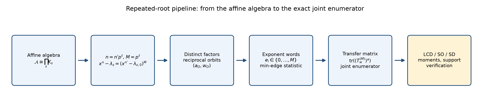
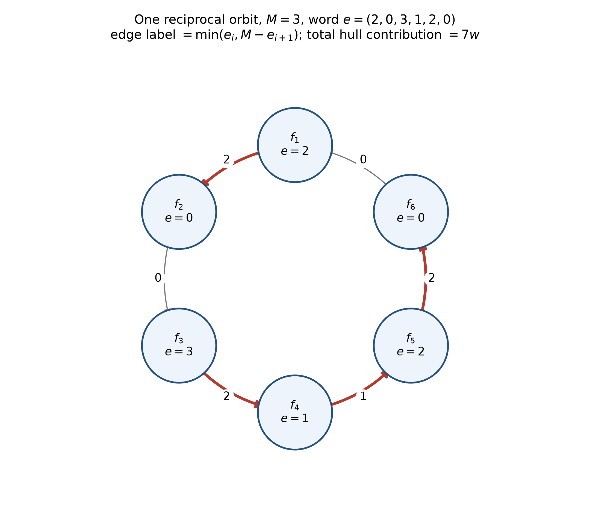
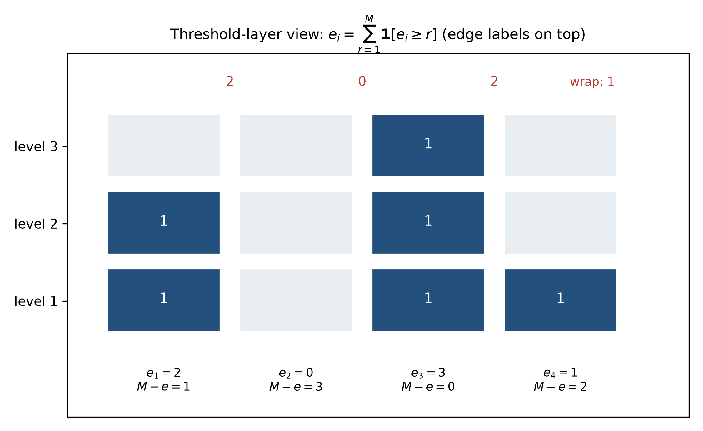
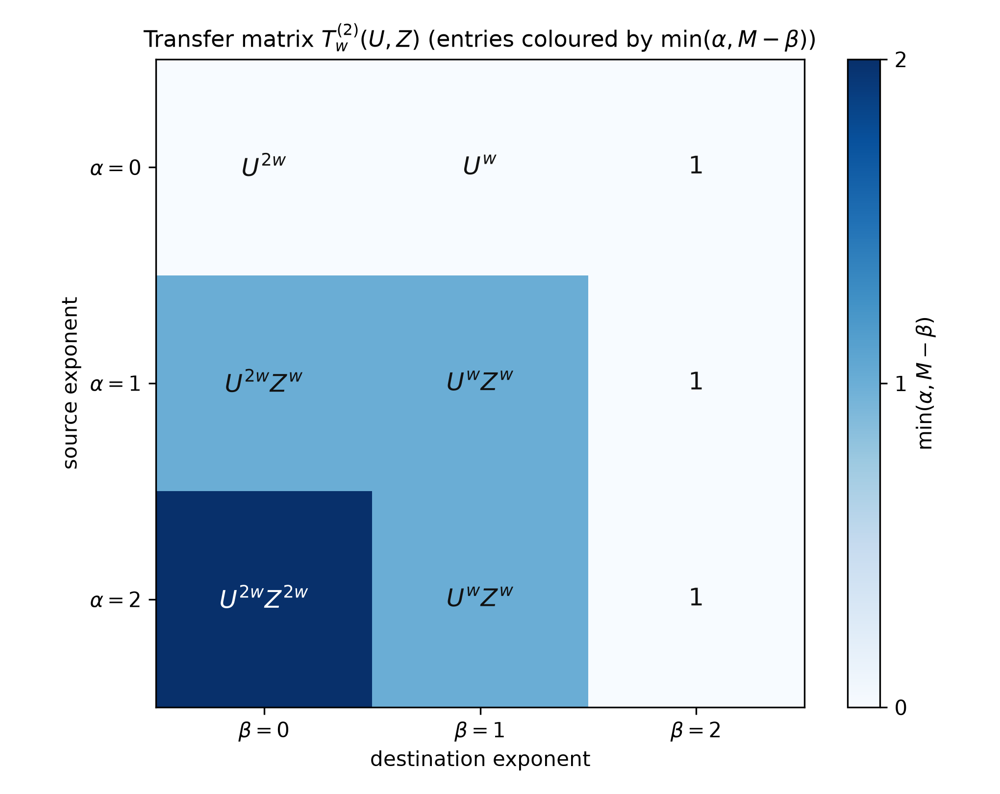
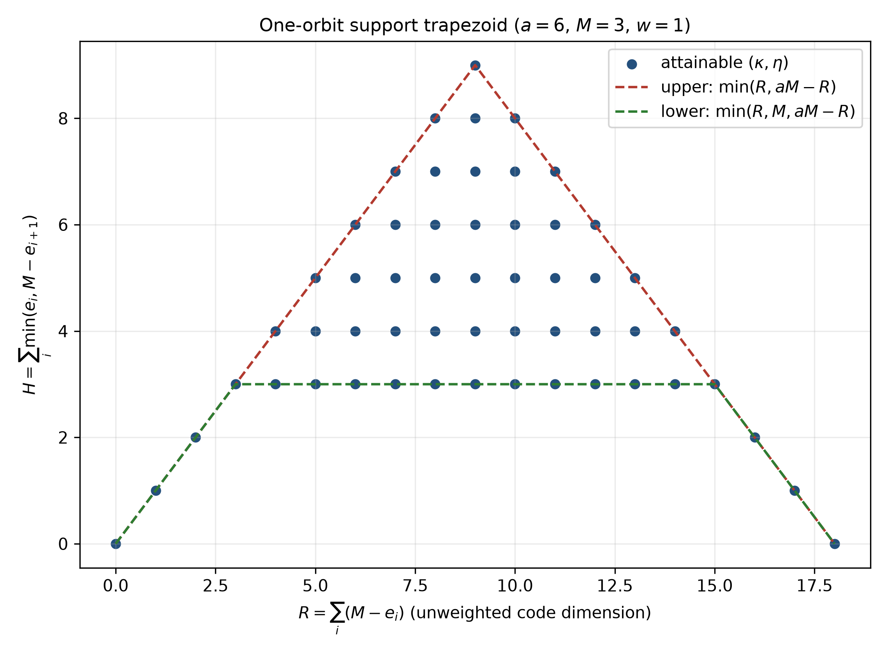
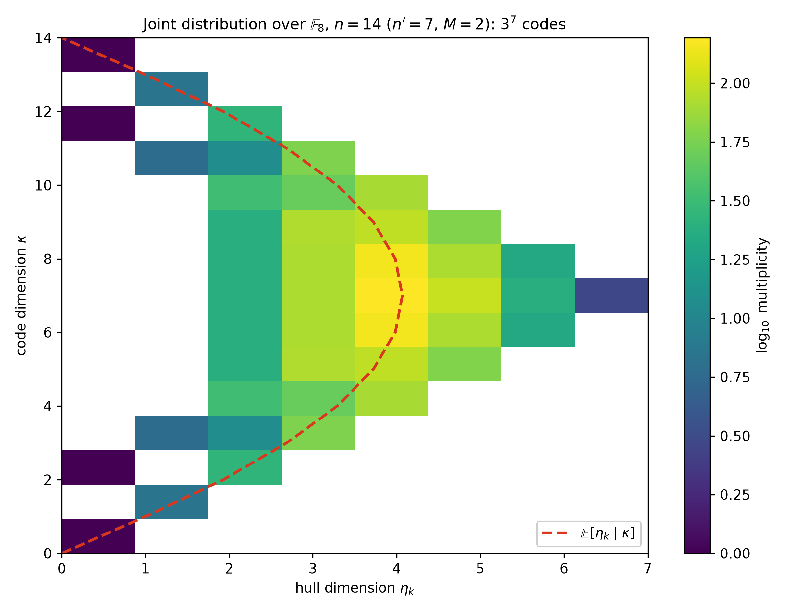
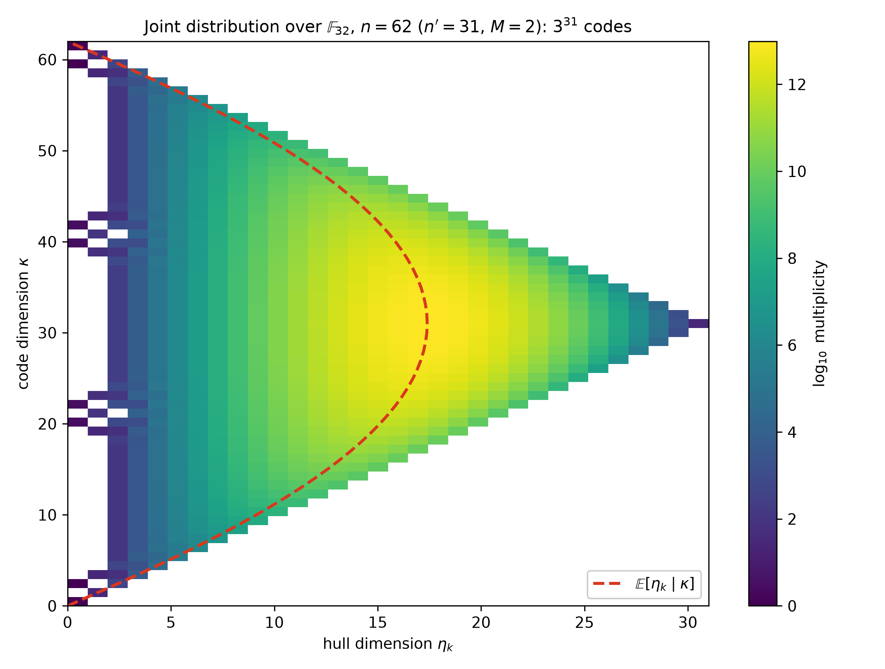
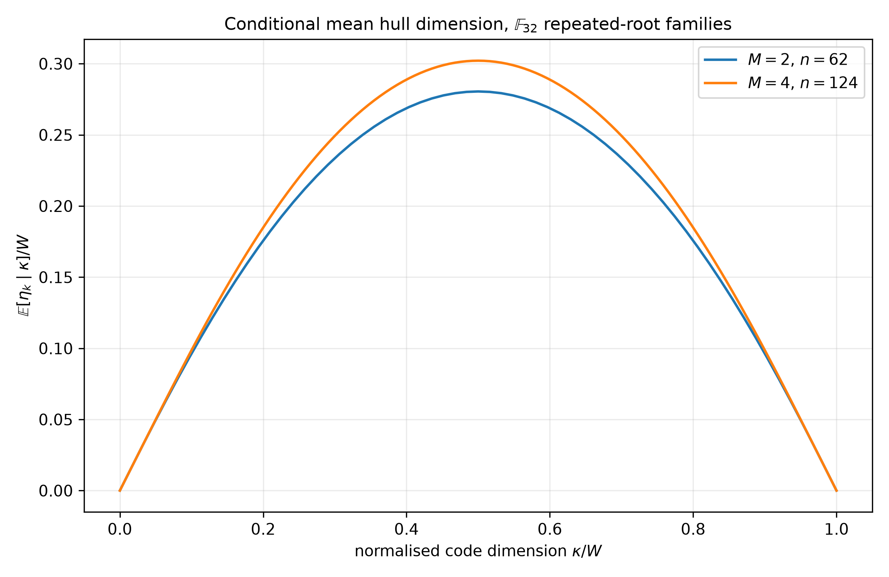
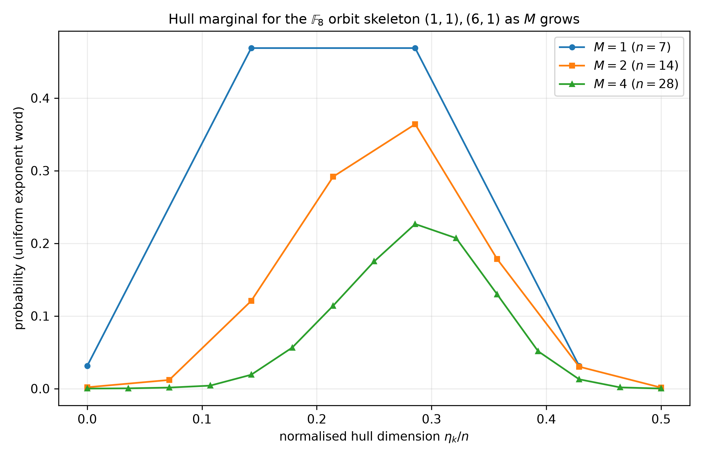

# Paper 2 Blueprint — Repeated-Root Joint Enumerators

## Proposed manuscript title

**Joint Code-Dimension and $k$-Galois-Hull Enumerators for Repeated-Root Constacyclic Codes over Square-Free Affine Algebras**

**Short working title:** Repeated-Root Galois-Hull Enumerators over Affine Algebras

**Blueprint version:** 1.0, 23 October 2026  
**Base manuscript:** *Joint Code-Dimension and $k$-Galois-Hull Enumerators for Simple-Root Constacyclic Codes over Square-Free Affine Algebra Ring* (Paper 1)  
**Target journal (first choice):** *Finite Fields and Their Applications*  
**Backup venues:** *Designs, Codes and Cryptography*; *Advances in Mathematics of Communications*; *Cryptography and Communications*

---

## Status labels used everywhere in this blueprint

| Label | Meaning |
|---|---|
| **[READY]** | The derivation is mathematically complete at blueprint level; only formal manuscript proof-writing remains. |
| **[PROOF-TARGET]** | The precise statement and a concrete proof strategy are given; one or more proof steps still have to be completed before the statement may be called a theorem. |
| **[COMPUTED]** | The statement/number has been verified by the code in this package, in the stated ranges. Computation is evidence, not a proof. |
| **[CHECK]** | A literature, convention, or bibliographic item that must be re-verified immediately before submission. |

> **One-sentence thesis of Paper 2.** Removing Paper 1's condition $\gcd(n,p)=1$ changes every binary factor selection into an exponent word $e_i\in\{0,\dots,p^t\}$, changes the hull statistic from a $1\to0$ transition count into a cyclic $\min$-edge statistic, and changes the $2\times2$ transfer matrix into an explicit $(p^t+1)\times(p^t+1)$ transfer matrix — from which the exact joint distribution of code dimension and $k$-Galois hull dimension, its moments, its support, and the exact LCD / self-orthogonal / dual-containing / self-dual counts all follow over square-free affine algebras, for compatible *and* incompatible twists.



*Figure 1. The repeated-root pipeline. Every box corresponds to one section of the proposed manuscript (see §11).*

---

## Table of contents

0. Executive summary and Paper 1 $\to$ Paper 2 difference table
1. Problem formulation, research questions, contributions, non-goals
2. Notation and standing assumptions
3. Algebraic foundations: affine algebra, repeated-root factorisation, exponent selections
4. $k$-Galois duality in the repeated-root case
5. Reciprocal orbits and the $\min$-edge hull formula
6. The joint enumerator and the $(M+1)$-state transfer matrix
7. Consequences: marginals, LCD invariance, support, moments, extremal classes
8. Algorithms, complexity, and computational verification design
9. Worked examples and computed tables
10. Proposed abstract, highlights, keywords
11. Manuscript section-by-section plan
12. Referee-objection register and risk controls
13. Literature-search protocol and bibliography plan
14. Work plan, roles, and decision gates
15. Package inventory and how to run everything
16. Appendices: formula sheet, pseudocode, joint matrices, glossary, checklists

---

## 0. Executive summary

### 0.1 What Paper 1 did

Paper 1 fixes a square-free affine algebra $\mathcal A\cong\prod_{s=1}^{N}K_s$, a length $n$ with $\gcd(n,p)=1$, and compatible twists. Every $\lambda$-constacyclic code is then a binary selection $J_s\subseteq\mathcal F_s$ of irreducible factors of $x^n-\lambda_s$. The $k$-Galois hull dimension is a weighted number of $1\to0$ transitions along reciprocal orbits, and the exact joint enumerator is a product of traces of a $2\times2$ matrix. Paper 1 explicitly leaves open: (i) repeated-root moduli, (ii) incompatible components inside the orbit product, and (iii) equivalence classes instead of labeled selections.

### 0.2 What Paper 2 will do

Write $n=n'p^t$ with $\gcd(n',p)=1$ and put $M=p^t$ ($t\ge0$, so $M=1$ is Paper 1). Then, componentwise,

$$
x^n-\lambda_s=\bigl(x^{n'}-\lambda_{s,0}\bigr)^M=\prod_{f\in\mathcal F_s} f^{M},
$$

where $\lambda_{s,0}$ is the unique element of $K_s^*$ with $\lambda_{s,0}^M=\lambda_s$. A code is now an **exponent selection** $e:\mathcal F_s\to\{0,\dots,M\}$. The whole programme of Paper 1 is re-derived in this setting, and at every point the repeated-root case is genuinely different:

| Object | Paper 1 ($M=1$) | Paper 2 ($M=p^t$) |
|---|---|---|
| Selection at one factor | bit $\varepsilon\in\{0,1\}$ | exponent $e\in\{0,\dots,M\}$ |
| Total labeled codes | $2^{N_F}$ | $(M+1)^{N_F}$ |
| Code-dim. contribution of a factor | $w(1-\varepsilon)$ | $w(M-e)$ |
| Hull contribution of an orbit edge $i\to i{+}1$ | $w\,\varepsilon_i(1-\varepsilon_{i+1})$ | $w\min\{e_i,\,M-e_{i+1}\}$ |
| Transfer matrix | $2\times2$ | $(M+1)\times(M+1)$ |
| Length-1 orbit hull | always $0$ | $w\min\{e,M-e\}$, generally $>0$ |
| Mean hull per edge ($a\ge2$) | $w/4$ | $w\,M(2M+1)/(6(M+1))$ |
| LCD words per orbit | $2$ (constant words) | **still $2$** — invariance theorem |
| Self-dual words per orbit | $2$ if $a$ even, else $0$ | $M+1$ if $a$ even; $1$ if $a$ odd and $M$ even; else $0$ |
| One-orbit support | $0\le\eta\le\min(\kappa,W-\kappa)$ with $\eta=0$ gaps | trapezoid $\min(R,M,aM-R)\le H\le\min(R,aM-R)$ |

### 0.3 Headline results to be claimed (after proofs are written)

1. **[READY] Main enumerator.** $\displaystyle \mathscr E^{(M)}(U,Z)=\prod_s\prod_{O\in\mathcal O_s}\operatorname{tr}\!\bigl(T^{(M)}_{w_O}(U,Z)^{a_O}\bigr)$ with $\bigl(T^{(M)}_w\bigr)_{\alpha\beta}=U^{w(M-\beta)}Z^{w\min\{\alpha,M-\beta\}}$.
2. **[READY] LCD invariance.** The number of $k$-Galois LCD codes is $2^{\sum_s|\mathcal O_s|}$, independent of $M$.
3. **[READY] Closed mean and variance** of $\eta_k$ for every $M$, with separate $a=1$, $a=2$, $a\ge3$ variance laws reducing to Paper 1 at $M=1$.
4. **[READY] Exact extremal counts.** Self-orthogonal and dual-containing counts as traces of explicit $(M+1)\times(M+1)$ 0–1 matrices; self-dual count in closed form per orbit.
5. **[PROOF-TARGET] Support trapezoid.** Exact one-orbit attainable region (bounds proved at blueprint level; attainability proof to be completed — §7.4).
6. **[COMPUTED] Big examples.** Exact enumerators for $\mathbb F_{32}$, $n=62$ ($3^{31}$ codes) and $n=124$ ($5^{31}$ codes), plus direct finite-field verification in characteristics $2,3,5$.

---

## 1. Problem formulation

### 1.1 The precise question

Fix the data of §2. For every pair $(\kappa,\eta)$ of non-negative integers, determine **exactly**

$$
N(\kappa,\eta)=\#\{C\subseteq\mathcal A^n:\ C\ \lambda\text{-constacyclic},\ \dim_{\mathbb F_q}C=\kappa,\ \dim_{\mathbb F_q}\operatorname{Hull}_{\mathcal A,k}(C)=\eta\},
$$

where now $\gcd(n,p)$ is arbitrary. Equivalently: compute the bivariate polynomial $\mathscr E^{(M)}(U,Z)=\sum_{\kappa,\eta}N(\kappa,\eta)U^\kappa Z^\eta$ in a form from which every $N(\kappa,\eta)$ can be extracted without enumerating $(M+1)^{N_F}$ codes.

### 1.2 Research questions and where each is answered

| # | Research question | Answer location (blueprint) | Manuscript item |
|---|---|---|---|
| RQ1 | What replaces binary factor selections when $p\mid n$? | §3.3 | Lemma (exponent-selection bijection) |
| RQ2 | What is the $k$-Galois dual generator when the modulus is a proper power? | §4.5 | Theorem (dual generator) |
| RQ3 | When does the reciprocal permute the same distinct-factor set? | §4.6 | Proposition (compatibility, unchanged condition) |
| RQ4 | What is $\eta_k$ as a function of the exponent word? | §5.3 | Proposition ($\min$-edge formula) |
| RQ5 | What is the exact joint generating polynomial? | §6.4 | **Main Theorem** |
| RQ6 | How many LCD / self-orthogonal / dual-containing / self-dual codes are there? | §7.2, §7.6 | Corollaries + Proposition |
| RQ7 | Which pairs $(\kappa,\eta)$ actually occur? | §7.3–7.4 | Proposition (hull values) + support theorem (target) |
| RQ8 | What are the mean, variance, and conditional law of $\eta_k$? | §7.5 | Corollaries (closed forms in $M$) |
| RQ9 | How expensive is exact computation, and how is it verified independently? | §8 | Complexity proposition + verification section |

### 1.3 Intended contributions (for the introduction)

1. A complete exponent-selection model of repeated-root $\lambda$-constacyclic codes over square-free affine algebras, with degrees of freedom $(M+1)^{N_F}$ and explicit $\mathbb F_q$-dimension weights — no coprimality condition between $n'$ and $\operatorname{ord}(\lambda_s)$ is imposed.
2. The $\min$-edge formula for the $k$-Galois hull dimension and the resulting $(M+1)$-state transfer-matrix enumerator, valid for arbitrary reciprocal-orbit lengths and heterogeneous component weights $w_O=m_sd_O$.
3. Population consequences unavailable from one-code hull formulas: both marginals, the $M$-independent LCD count, closed mean/variance as rational functions of $M$, conditional moments at fixed $\kappa$, and hull-value support.
4. Exact counts of $k$-Galois self-orthogonal, dual-containing, and self-dual codes, including a per-orbit existence criterion for self-dual codes.
5. A treatment of **all** twists: incompatible components are proved to have trivial hull, so the enumerator plus one remark covers every $\lambda\in\mathcal A^*$.
6. Independent computational verification by generator-matrix/Gram-rank hull computations over the component fields, and exact big examples ($3^{31}$ and $5^{31}$ codes) that exhaustive enumeration cannot touch.

### 1.4 Non-goals (state them; they prevent referee scope-creep)

- **Minimum distance / weight enumerators.** Distance is not additive over reciprocal orbits; a trivariate $(\kappa,\eta,d)$ enumerator over all selections is a different problem. (BCH-subfamily work is a possible Paper 4.)
- **Equivalence classes.** Counting remains labeled, as in Paper 1. A Burnside–Pólya version is reserved for Paper 3.
- **Non-square-free $\mathcal A$** (nilpotents / chain-ring components). The algebra stays square-free; only the *code modulus* becomes non-square-free. This distinction must be one explicit sentence in the abstract and introduction.
- **$\mathbb F_q$-linear but not $\mathcal A$-linear shift-invariant subspaces.** Not counted (same caveat as Paper 1).
- **Quantum-code parameter tables.** EAQECCs motivate hull dimensions in the introduction only; no parameter claims are made, because Paper 2 does not control distance.

### 1.5 Novelty boundary **[CHECK before submission]**

Position the paper against these nearest neighbours (verify §13 list again at submission time):

- Debnath–Islam–Martínez-Moro–Prakash, *Galois hulls of constacyclic codes over affine algebra rings* (Discrete Math. 2026): generators and hull dimension of **one** code, LCD criterion, EAQECCs — under extra hypotheses $n=n'p^{e'}$, $\gcd(\operatorname{ord}\lambda,n')=1$. Paper 2's contribution is the **population-level joint distribution** with **no** $\operatorname{ord}(\lambda)$ condition. Where the settings overlap, show the formulas agree via $M-\max\{e_i,M-e_{i-1}\}=\min\{e_{i-1},M-e_i\}$ (§5.6).
- Debnath–Prakash (2025): **average** hull dimensions only — first moments of Paper 2's distribution (in the field/simple cases). Check in an example whether their average at $M=1$ matches Paper 1/Paper 2 means; cite as a consistency check if it does.
- Debnath et al. (2023, + correction): prescribed-hull counts over **fields**, simple-root, with parameter restrictions. Paper 2 is over affine algebras, repeated-root, and joint in $(\kappa,\eta)$.
- Sangwisut et al. (2015); Skersys (2003); Jitman–Sangwisut (2018): Euclidean/Hermitian special cases over fields — recovered at $k=0$ / Hermitian $k$ and $N=1$.
- Repeated-root structure theory (Castagnoli–Massey–Schoeller–von Seemann 1991; van Lint 1991; Dinh and successors): factorisations and code/dual descriptions for specific lengths — not hull distributions. Paper 2 needs only the elementary factorisation $(x^{n'}-\lambda_0)^M$, but must cite this line so the repeated-root setup does not look unmotivated.

---

## 2. Notation and standing assumptions

### 2.1 Notation table (use exactly this in the manuscript)

| Symbol | Meaning |
|---|---|
| $p$, $q=p^e$ | prime characteristic; base-field order, $e\ge1$ |
| $k$, $0\le k<e$ | Galois twist exponent. (Some literature uses $\ell$; never mix.) |
| $s\in\{1,\dots,N\}$ | component index of $\mathcal A$ |
| $K_s=\mathbb F_{q^{m_s}}=\mathbb F_{p^{d_s}}$, $d_s=em_s$ | component field; absolute degree |
| $\mathcal A\cong\prod_s K_s$ | fixed labeled square-free affine algebra (Paper 1, Prop. 2.1) |
| $n=n'p^t$, $\gcd(n',p)=1$ | code length; $t=v_p(n)\ge0$ |
| $M=p^t$ | **multiplicity** of every distinct irreducible factor of $x^n-\lambda_s$ |
| $\lambda_s\in K_s^*$; $\lambda_{s,0}$ | component twist; the unique $M$-th root $\lambda_{s,0}^M=\lambda_s$ |
| $P_s(x)=x^n-\lambda_s$ | component modulus. (Not $M_s$ — $M$ is taken.) |
| $\mathcal F_s$ | distinct monic irreducible factors of $x^{n'}-\lambda_{s,0}$ over $K_s$ |
| $e=(e_f)_{f\in\mathcal F_s}$, $0\le e_f\le M$ | **exponent selection**. (Never use $u$ — $U$ is a variable.) |
| $g_e=\prod f^{e_f}$, $h_e=P_s/g_e$ | generator and parity-check polynomials |
| $C_s(e)=\langle g_e\rangle$ | component code; $C(e)=\prod_s C_s(e)$ global code |
| $\sigma_{s,k}(a)=a^{p^k}$, $\rho_{s,k}=\sigma_{s,k}^{-1}$ | Frobenius and its inverse on $K_s$ |
| $f^{\#_{s,k}}$, $\tau_{s,k}$ | normalised inverse-Frobenius reciprocal; induced factor permutation |
| $\mathcal O_s$; $O\in\mathcal O_s$ | reciprocal orbits; $a_O=|O|$, $d_O$ common factor degree, $w_O=m_sd_O$ |
| $e_{O,i}$, $i\in\mathbb Z/a_O$ | exponent word on an orbit, ordered by $\tau_{s,k}$ |
| $\kappa(C)$, $\eta_k(C)$ | $\mathbb F_q$-dimensions of code and $k$-Galois hull |
| $W=n\sum_s m_s$ | $\mathbb F_q$-dimension of the ambient space $\mathcal A^n$ |
| $N_F=\sum_s|\mathcal F_s|$ | total number of distinct factors |
| $U,Z$ | enumerator variables marking $\kappa$ and $\eta_k$ (capital, to avoid clash with exponents) |
| $\mathscr E^{(M)}(U,Z)$, $\mathscr H^{(M)}(Z)$ | joint enumerator; hull polynomial $\mathscr E^{(M)}(1,Z)$ |
| $T^{(M)}_w(U,Z)$ | $(M+1)\times(M+1)$ transfer matrix, states $0,\dots,M$ |
| $\Phi_j(\kappa)$ | $[U^\kappa]\,\partial_Z^j\mathscr E^{(M)}(U,Z)\big|_{Z=1}$, $j=0,1,2$ |
| $D_k(\cdot)$, $\operatorname{Hull}_k(\cdot)$ | $k$-Galois dual and hull (componentwise); $D_{\mathcal A,k}$, $\operatorname{Hull}_{\mathcal A,k}$ globally |

### 2.2 Standing assumptions (the "box" to print in Section 2 of the manuscript)

- **A1.** $\mathcal A$ is square-free with fixed labeled decomposition $\mathcal A\cong\prod_{s=1}^N K_s$ (exactly as Paper 1). *Only the code modulus is allowed to be non-square-free.*
- **A2.** $n=n'p^t$ with $t\ge0$, $\gcd(n',p)=1$; $M=p^t$. The case $t=0$ is Paper 1 and is included for uniformity.
- **A3.** $\lambda=(\lambda_s)_s\in\mathcal A^*$ arbitrary. The orbit product is stated under the compatibility condition (§4.6); incompatible components are disposed of in §4.7. Together they cover **all** $\lambda$.
- **A4.** Codes are $\mathcal A$-linear $\lambda$-constacyclic codes, i.e. ideals of $\mathcal A[x]/\langle x^n-\lambda\rangle$ (Definition as in Paper 1).
- **A5.** Dimensions of global objects are over $\mathbb F_q$; component dimensions over $K_s$ are converted by $m_s=[K_s:\mathbb F_q]$.
- **A6.** Counting is labeled: distinct exponent selections give distinct codes; no quotient by equivalence.
- **A7.** The $k$-Galois pairing is code-first: $\langle x,y\rangle_{s,k}=\sum_i x_iy_i^{p^k}$ (see §4.8 for the other convention in the literature).
- **A8.** Probabilistic statements use the uniform measure on the finite set of labeled exponent selections.

### 2.3 Two traps this notation avoids

1. **$M$ vs. modulus.** Paper 1 called the modulus $M_s(x)$. In Paper 2, $M$ is the multiplicity; the modulus is $P_s(x)$. One footnote in the manuscript prevents a very confusing collision.
2. **$\lambda_s$ vs. $\lambda_{s,0}$.** The generator divides $x^n-\lambda_s$, but factorisation, $\tau_{s,k}$, and all examples must be computed from $x^{n'}-\lambda_{s,0}$. Every example table must state **both** numbers (see Table 5 in §9, where e.g. $\lambda_0=\omega$ forces $\lambda=\omega^2$ at $M=2$).

---

## 3. Algebraic foundations

### 3.1 The square-free affine algebra (recap, half a page)

Reuse Paper 1 §2.1 verbatim in substance: $\mathcal A=\mathbb F_q[X_1,\dots,X_\ell]/\langle t_1(X_1),\dots,t_\ell(X_\ell)\rangle$ with $t_i$ monic square-free is finite étale, hence $\mathcal A\cong\prod_s K_s$ with fixed CRT idempotents $e_s$. **Concept in one line:** *square-free* describes the coefficient algebra $\mathcal A$; in Paper 2 the polynomial $x^n-\lambda_s$ is deliberately **not** square-free.

### 3.2 The repeated-root factorisation **[READY]**

**Lemma 3.2 (factorisation).** *Let $n=n'p^t$, $M=p^t$, $\lambda_s\in K_s^*$, and let $\lambda_{s,0}=\mathrm{Frob}^{-t}(\lambda_s)$ be the unique element of $K_s^*$ with $\lambda_{s,0}^M=\lambda_s$. Then*
$$
x^n-\lambda_s=\bigl(x^{n'}-\lambda_{s,0}\bigr)^M,
$$
*and $x^{n'}-\lambda_{s,0}$ is square-free. Hence every distinct monic irreducible factor of $x^n-\lambda_s$ over $K_s$ occurs with multiplicity exactly $M$.*

*Proof ingredients.* (i) $a\mapsto a^{p^t}$ is an automorphism of $K_s$, so $\lambda_{s,0}$ exists and is unique. (ii) In characteristic $p$, $(x^{n'}-\lambda_{s,0})^{p^t}=x^{n'p^t}-\lambda_{s,0}^{p^t}$ (freshman's dream applied to polynomial coefficients). (iii) $\gcd(x^{n'}-\lambda_{s,0},\,n'x^{n'-1})=1$ because $\gcd(n',p)=1$ and $\lambda_{s,0}\ne0$, so the base polynomial is separable, i.e. square-free. $\square$

**Remark (include in manuscript).** This is the whole factorisation theory Paper 2 needs: in the finite-field case every repeated-root constacyclic modulus is a pure $p^t$-power of a simple-root modulus. No hypothesis on $\operatorname{ord}(\lambda_s)$ is used — contrast with the affine-algebra hull paper of Debnath et al. **[CHECK the exact comparison statement against their Theorem 8 before submission.]**

### 3.3 Codes = exponent selections **[READY]**

**Lemma 3.3 (component bijection).** *The $\lambda_s$-constacyclic codes in $K_s[x]/\langle P_s\rangle$ are exactly the ideals $\langle g_e\rangle$ with $g_e=\prod_{f\in\mathcal F_s}f^{e_f}$, $0\le e_f\le M$. Moreover*
$$
\dim_{K_s}C_s(e)=n-\sum_f e_f\deg f=\sum_f (M-e_f)\deg f.
$$

*Proof ingredients.* $K_s[x]$ is a PID, so ideals of the quotient are principal, generated by monic divisors of $P_s$; by Lemma 3.2 a monic divisor is exactly a choice of exponents $e_f\in\{0,\dots,M\}$. Dimension $=n-\deg g_e$. $\square$

**Lemma 3.4 (global bijection).** *The map $e=(e^{(s)})_s\mapsto C(e)=\prod_s C_s(e^{(s)})$ is a bijection from $\prod_s\{0,\dots,M\}^{\mathcal F_s}$ to the set of $\lambda$-constacyclic codes of length $n$ over $\mathcal A$. In particular the total number of labeled codes is $(M+1)^{N_F}$, and*
$$
\kappa(C(e))=\sum_{s}\sum_{f\in\mathcal F_s} m_s(\deg f)\,(M-e_f).
$$

*Proof ingredients.* Identical idempotent argument to Paper 1, Lemmas 2.4–2.5: $C=\bigoplus_s e_sC$ with $e_sC$ an ideal of $K_s[x]/\langle x^n-\lambda_s\rangle$; apply Lemma 3.3 componentwise; convert dimensions by $m_s$. Square-freeness of $P_s$ was never used in that argument — say so explicitly. $\square$

**Concept in one line:** Paper 1 flipped a coin at each factor (in/out of the generator). Paper 2 turns a dial with $M+1$ positions at each factor.

### 3.4 Shift definition and the $\mathcal A$-linearity caveat

Keep Paper 1's Definition 2.3 unchanged ($\lambda$-shift $T_\lambda$; $\mathcal A$-submodule closed under $T_\lambda$ $\iff$ ideal of $\mathcal A[x]/\langle x^n-\lambda\rangle$) and its remark that merely $\mathbb F_q$-linear shift-invariant subspaces are not counted. Nothing in the definition requires $\gcd(n,p)=1$.

---

## 4. $k$-Galois duality in the repeated-root case

### 4.1 Pairing, dual, hull (recap with the one new observation)

Componentwise $\langle x,y\rangle_{s,k}=\sum_i x_iy_i^{p^k}$ on $K_s^n$; $\sigma_{s,k}$-semilinear in the second argument; $D_k(C)=\{y:\langle c,y\rangle_{s,k}=0\ \forall c\in C\}$; $\operatorname{Hull}_k(C)=C\cap D_k(C)$. Global versions via the $\mathcal A$-valued pairing $\langle x,y\rangle_{\mathcal A,k}=\sum_i x_i\sigma_{\mathcal A,k}(y_i)$, exactly as in Paper 1 §2.3. The decomposition lemmas $D_{\mathcal A,k}(C(e))=\prod_s D_k(C_s(e))$ and $\operatorname{Hull}_{\mathcal A,k}(C(e))=\prod_s\operatorname{Hull}_k(C_s(e))$ go through unchanged (they are product arguments, indifferent to $p\mid n$).

> **Euclidean/Hermitian terminology warning (repeat from Paper 1).** $k=0$ is Euclidean on every component. The pairing on $K_s=\mathbb F_{p^{d_s}}$ is Hermitian iff $d_s$ is even and $k=d_s/2$; the base-field choice $k=e/2$ need not be Hermitian on components with $m_s>1$. Never write "the Hermitian case" without this qualification.

### 4.2 The dual-translation identity **[READY]**

$D_k(C)=\rho_{s,k}(C^{\perp_E})$ coordinatewise (Paper 1, Prop. 2.7). Proof unchanged. This is the bridge that reduces everything to ordinary Euclidean duality of constacyclic codes, which is where the repeated-root check in §4.4 matters.

### 4.3 The inverse-Frobenius reciprocal **[READY]**

For monic $f=\sum_{i=0}^r f_ix^i$, $f_0\ne0$:
$$
f^{\#_{s,k}}(x)=\rho_{s,k}(f_0)^{-1}\sum_{i=0}^r\rho_{s,k}(f_i)x^{r-i}.
$$
Facts needed (Paper 1, Lemmas 3.1–3.2, proof unchanged): monic; degree-preserving; multiplicative on monic polynomials with $f_0\ne0$ — hence in particular $(f^m)^{\#}=(f^{\#})^m$ for every $m\ge0$, the one place where multiplicities enter; preserves irreducibility; root action $\alpha\mapsto\alpha^{-p^{d_s-k}}$.

### 4.4 Euclidean dual of a repeated-root constacyclic code **[READY — the only proof that must be rechecked line by line]**

**Lemma 4.4.** *Let $G\mid x^n-a$ be monic in $K[x]$, $H=(x^n-a)/G$, and $H^*$ the ordinary normalised reciprocal. Then the Euclidean dual of $\langle G\rangle\subseteq K[x]/\langle x^n-a\rangle$ is the $a^{-1}$-constacyclic ideal generated by $H^*$.*

*Why square-freeness is irrelevant.* Paper 1's proof (Lemma 3.4 there) uses only: (i) the $n-\deg G$ non-wrapped shifts $x^iG$ are a basis; (ii) orthogonality of non-wrapped shifts of $G$ and $H^*$ reduces to middle coefficients of $GH=x^n-a$ being $0$; (iii) $H^*\mid x^n-a^{-1}$ via $H^*(x)=H(0)^{-1}x^{\deg H}H(x^{-1})$; (iv) dimension count. None of (i)–(iv) sees whether $x^n-a$ has repeated factors. **In the manuscript, reproduce the proof and add one sentence:** "No step uses that $x^n-a$ is square-free; multiplicities are carried along by $H$." This pre-empts the first referee question.

### 4.5 The $k$-Galois dual generator **[READY]**

**Theorem 4.5.** *Let $C_s(e)=\langle g_e\rangle$ and $h_e=P_s/g_e=\prod_f f^{M-e_f}$. Then $D_k(C_s(e))$ is generated by $h_e^{\#_{s,k}}$ and is $\lambda_s^{-p^{d_s-k}}$-constacyclic. The exponent of the distinct factor $f$ in $h_e^{\#_{s,k}}$ is $M-e_{\tau_{s,k}^{-1}(f)}$ whenever $\tau_{s,k}$ is defined (compatible case, §4.6).*

*Proof ingredients.* $D_k=\rho(\perp_E)$ by §4.2; Lemma 4.4 gives generator $h_e^*$ and twist $\lambda_s^{-1}$; applying $\rho_{s,k}$ coefficientwise sends $h_e^*\mapsto h_e^{\#_{s,k}}$ and $\lambda_s^{-1}\mapsto\lambda_s^{-p^{d_s-k}}$. Exponents: $\#$ is multiplicative, sends $f\mapsto f^\#=\tau_{s,k}(f)$ with the same exponent, so the factor $\tau_{s,k}(f)$ inherits exponent $M-e_f$; re-index. $\square$

### 4.6 Compatibility — the condition does not change **[READY]**

The reciprocal sends roots of $x^{n'}-\lambda_{s,0}$ to roots of $x^{n'}-\lambda_{s,0}^{-p^{d_s-k}}$ (root action $\alpha\mapsto\alpha^{-p^{d_s-k}}$ and $\alpha^{n'}=\lambda_{s,0}$). Hence $\tau_{s,k}$ permutes $\mathcal F_s$ iff

$$
\lambda_{s,0}^{\,1+p^{d_s-k}}=1. \tag{$\ast$}
$$

**Proposition 4.6.** *Condition $(\ast)$ is equivalent to Paper 1's condition $\lambda_s^{1+p^{d_s-k}}=1$.*

*Proof.* Put $c=1+p^{d_s-k}$. Then $\lambda_s^c=(\lambda_{s,0}^M)^c=(\lambda_{s,0}^c)^M$. The map $y\mapsto y^M=y^{p^t}$ on $K_s^*$ is a Frobenius power, hence injective with $1^M=1$; so $(\lambda_{s,0}^c)^M=1\iff\lambda_{s,0}^c=1$. $\square$

Under $(\ast)$: the dual twist $\lambda_s^{-p^{d_s-k}}$ equals $\lambda_s$, $\tau_{s,k}:\mathcal F_s\to\mathcal F_s$ is a permutation preserving degrees, and everything in §5–§7 applies.

**Special cases worth one remark.** $\lambda_s=1$ (cyclic) and $\lambda_s=-1$ (negacyclic) always satisfy $(\ast)$: for odd $p$, $(-1)^{1+p^{d_s-k}}=1$ because $p^{d_s-k}$ is odd; for $p=2$, $-1=1$.

### 4.7 Incompatible twists: everything is LCD **[READY]**

**Proposition 4.7.** *If $\lambda_{s,0}^{1+p^{d_s-k}}\ne1$ for a component $s$, then $\operatorname{Hull}_k(C_s(e))=\{0\}$ for every exponent selection $e$.*

*Proof ingredients.* Put $\mu_{s,0}=\lambda_{s,0}^{-p^{d_s-k}}\ne\lambda_{s,0}$. The dual generator divides $(x^{n'}-\mu_{s,0})^M$ while $g_e$ divides $(x^{n'}-\lambda_{s,0})^M$; the two base polynomials differ by the nonzero constant $\mu_{s,0}-\lambda_{s,0}$, hence are coprime, hence so are their $M$-th powers and the two generators. Their degrees sum to $n$. A hull word, as a polynomial of degree $<n$, is divisible by both generators, hence by their product of degree $n$, hence is $0$. $\square$

**Consequences to state.** (a) For a mixed algebra with some incompatible components, the global enumerator is the product of the compatible components' orbit factors times, for each incompatible component, the dimension-only factor $\prod_{f\in\mathcal F_s}\bigl(1+U^{w_f}+\dots+U^{Mw_f}\bigr)$ (all $\eta$-exponents $0$). (b) In an incompatible component the only self-orthogonal code is $\{0\}$, the only dual-containing code is the whole space, and there is no self-dual code ($n\ge1$) — because self-orthogonality forces $\operatorname{Hull}_k(C)=C$.

**Worked mini-example [COMPUTED].** $K=\mathbb F_5$, $n'=2$, $M=5$, $n=10$, $k=0$, $\lambda_0=\lambda=2$: $x^2-2$ is irreducible over $\mathbb F_5$, $\lambda^{1+5}=2^6=4\ne1$. The six codes $\langle(x^2-2)^e\rangle$, $e=0,\dots,5$, have $(\kappa,\eta_0)=(10,0),(8,0),(6,0),(4,0),(2,0),(0,0)$ — verified directly by Gram-matrix computation in this package's pilot runs.

### 4.8 Code-first vs. candidate-first conventions (keep Paper 1's remark)

Some of the literature defines the Galois dual by $\sum_i y_i\sigma(c_i)=0$ ("candidate-first"). The two duals satisfy $D_{\mathrm{cand}}(C)=\sigma_{s,k}^2(D_k(C))$; they are different subspaces in general, **but** for the same code both hull dimensions equal $\dim C-\operatorname{rank}(B\sigma(B)^T)$ for any row basis $B$ of $C$ (Paper 1, Remark 3.8(b)). Therefore: (i) every hull-**dimension** statement in Paper 2 is convention-independent; (ii) generator/support statements are for the code-first dual and must say so; (iii) the Gram-rank identity is exactly what the verification code implements (§8.4). When comparing exponent formulas with Debnath et al., align conventions first, then indices. **[CHECK their convention before writing the comparison paragraph.]**

---

## 5. Reciprocal orbits and the $\min$-edge hull formula

### 5.1 Orbits and weights

Assume compatibility. $\tau_{s,k}$ permutes the **distinct** factor set $\mathcal F_s$ (multiplicities do not create new factors). Its cycles $O\in\mathcal O_s$ have constant factor degree $d_O$; write $a_O=|O|$, $w_O=m_sd_O$, and list $O=(f_1,\dots,f_{a_O})$ with $\tau_{s,k}(f_i)=f_{i+1}$ (indices mod $a_O$). An exponent selection restricts to an **exponent word** $(e_1,\dots,e_{a_O})\in\{0,\dots,M\}^{a_O}$ on each orbit, independently across orbits. This independence is the engine of everything that follows.

### 5.2 Dual and hull exponents **[READY]**

On one orbit, with indices mod $a=a_O$:

| Polynomial | exponent at $f_i$ |
|---|---|
| generator $g_e$ | $e_i$ |
| $h_e=P_s/g_e$ | $M-e_i$ |
| dual generator $h_e^{\#}$ | $M-e_{i-1}$ |
| hull generator $\operatorname{lcm}(g_e,h_e^{\#})$ | $\max\{e_i,\,M-e_{i-1}\}$ |

The hull of two principal ideals in $K_s[x]/\langle P_s\rangle$ is generated by the lcm of the generators (a word of degree $<n$ lies in both ideals iff it is divisible by both monic generators). The $K_s$-dimension contributed by $f_i$ to the hull is therefore $(\deg f_i)\bigl(M-\max\{e_i,M-e_{i-1}\}\bigr)=(\deg f_i)\min\{e_{i-1},\,M-e_i\}$.

### 5.3 The $\min$-edge formula **[READY]**

**Proposition 5.3 (hull dimension).** *Under compatibility,*
$$
\eta_k(C(e))=\sum_{s=1}^N\sum_{O\in\mathcal O_s} w_O\sum_{i=1}^{a_O}\min\{e_{O,i},\,M-e_{O,i+1}\},
\qquad
\kappa(C(e))=\sum_{s,O} w_O\sum_{i=1}^{a_O}(M-e_{O,i}).
$$

(Re-indexing $i-1\mapsto i$ in §5.2.) Both statistics are sums over orbits, and on each orbit $\kappa$ is a sum over **vertices** while $\eta_k$ is a sum over **directed edges** $i\to i{+}1$.



*Figure 2. One orbit with $M=3$ and word $e=(2,0,3,1,2,0)$. Edge labels are $\min\{e_i,M-e_{i+1}\}$; the hull contribution is $(2+0+2+1+2+0)w=7w$, and the code-dimension contribution is $\bigl(\sum_i(3-e_i)\bigr)w=10w$.*

### 5.4 Threshold-layer interpretation (intuition + a proof tool)

Write $e_i=\sum_{r=1}^M\varepsilon_i^{(r)}$ with $\varepsilon_i^{(r)}=\mathbf 1[e_i\ge r]$ — each exponent is a stack of $M$ binary layers, nested decreasingly in $r$. Then

$$
\min\{e_i,\,M-e_{i+1}\}=\sum_{r=1}^M \varepsilon_i^{(r)}\bigl(1-\varepsilon_{i+1}^{(M+1-r)}\bigr),
$$

because $\min\{a,M-b\}=\#\{r: r\le a,\ r\le M-b\}$. So the repeated-root hull statistic is a sum of Paper-1-type $1\to0$ transitions, but layer $r$ at position $i$ is paired with the **reversed** layer $M+1-r$ at position $i+1$, and the layers are nested, not independent. This identity is the conceptual bridge to Paper 1 and the natural tool for the support lower bound in §7.4.



*Figure 3. Threshold layers for $e=(2,0,3,1)$, $M=3$. Dark cells are $\varepsilon_i^{(r)}=1$. Red numbers are the edge contributions $\min\{e_i,M-e_{i+1}\}$.*

### 5.5 Recovery of Paper 1 and comparison with the $\max$-formula in the literature

- At $M=1$: $\min\{e_i,1-e_{i+1}\}=e_i(1-e_{i+1})$ for $e_i\in\{0,1\}$ — Paper 1's boundary statistic.
- Debnath et al.'s hull formula over affine algebras is written through the hull **generator** exponents $\max\{u_i,p^{e'}-u_{i-1}\}$. The identity $\;M-\max\{e_i,M-e_{i-1}\}=\min\{e_{i-1},M-e_i\}$ shows the two formulas describe the same number (generator degree vs. complementary hull dimension), after matching the factor ordering and the dual convention. Include this as a short "compatibility with [Debnath et al.]" remark with the index alignment done once, carefully. **[CHECK]**

### 5.6 A telescoping identity (used for symmetry)

For any $a,b\in\{0,\dots,M\}$: $\min\{a,M-b\}-\min\{M-a,b\}=a-b$ (check the two cases $a+b\le M$ and $a+b\ge M$). Summing over a cycle, the right side telescopes to $0$. Consequences: the map $e_i\mapsto M-e_{i-1}$ (passage to the dual code's exponents, up to the orbit shift) preserves $\eta_k$ while sending $\kappa\mapsto W-\kappa$; hence the joint distribution is symmetric:

$$
N(\kappa,\eta)=N(W-\kappa,\eta)\qquad\text{[READY, and COMPUTED]}.
$$

In particular $\operatorname{Cov}(\kappa,\eta_k)=0$ under the uniform measure (§7.5), even though $\kappa$ and $\eta_k$ are strongly dependent (Figure 8).

---

## 6. The joint enumerator and the $(M+1)$-state transfer matrix

### 6.1 Local statistics are edge/vertex weights on a cycle

Fix one orbit of length $a$ and weight $w$. A word $e\in\{0,\dots,M\}^a$ contributes the monomial $U^{w\sum_i(M-e_i)}Z^{w\sum_i\min\{e_i,M-e_{i+1}\}}$. Assign to each directed edge $\alpha\to\beta$ (source exponent $\alpha=e_i$, destination $\beta=e_{i+1}$) the weight of its destination vertex and of the edge statistic:

$$
\boxed{\;\bigl(T^{(M)}_w(U,Z)\bigr)_{\alpha,\beta}=U^{\,w(M-\beta)}\,Z^{\,w\min\{\alpha,\,M-\beta\}},\qquad \alpha,\beta\in\{0,\dots,M\}.\;}
$$



*Figure 4. The matrix $T^{(2)}_w(U,Z)$. At $M=1$ this collapses to Paper 1's $\bigl(\begin{smallmatrix}U^w&1\\ U^wZ^w&1\end{smallmatrix}\bigr)$ (delete the middle row/column and rename).*

### 6.2 Trace lemma **[READY]**

**Lemma 6.2.** *For every $a\ge1$,*
$$
\operatorname{tr}\bigl(T^{(M)}_w(U,Z)^a\bigr)=\sum_{e\in\{0,\dots,M\}^a}U^{w\sum_i(M-e_i)}Z^{w\sum_i\min\{e_i,M-e_{i+1}\}}.
$$

*Proof.* Expand a diagonal entry of the $a$-th power as a sum over closed walks of length $a$ on the state set $\{0,\dots,M\}$; the product of edge weights along the walk $e_1\to e_2\to\dots\to e_a\to e_1$ is the displayed monomial, each vertex counted once as a destination. $\square$

### 6.3 Main theorem **[READY]**

> **Theorem 6.3 (Main Theorem).** *Under the standing assumptions A1–A8 and the compatibility condition $\lambda_s^{1+p^{d_s-k}}=1$ for all $s$,*
> $$
> \mathscr E^{(M)}(U,Z):=\sum_{C}U^{\kappa(C)}Z^{\eta_k(C)}=\prod_{s=1}^{N}\prod_{O\in\mathcal O_s}\operatorname{tr}\!\Bigl(T^{(M)}_{w_O}(U,Z)^{a_O}\Bigr).
> $$
> *The coefficient $[U^\kappa Z^\eta]\mathscr E^{(M)}(U,Z)$ is the exact number of $\lambda$-constacyclic codes $C\subseteq\mathcal A^n$ with $\mathbb F_q$-dimension $\kappa$ and $k$-Galois hull $\mathbb F_q$-dimension $\eta$.*

**Proof skeleton (7 steps, mirroring Paper 1 so a referee can diff the two):**
1. Exponent-selection bijection (Lemma 3.4) $\Rightarrow$ selections factor as $\prod_{s,O}\{0,\dots,M\}^{a_O}$.
2. Global dual/hull decompose over components (§4.1).
3. Dual exponents via Theorem 4.5; hull exponents via lcm (§5.2).
4. $\kappa$ and $\eta_k$ are additive over orbits with weights $w_O$ (Proposition 5.3).
5. One orbit is enumerated by the trace (Lemma 6.2).
6. Products of generating polynomials convolve independent additive statistics.
7. Coefficient interpretation; specialise $(U,Z)=(1,1)$ to recover $(M+1)^{N_F}$ as a checksum. $\square$

### 6.4 Immediate specialisations

- **Total:** $\mathscr E^{(M)}(1,1)=(M+1)^{N_F}$.
- **Code-dimension marginal:** $\mathscr E^{(M)}(U,1)=\prod_{s}\prod_{f\in\mathcal F_s}\bigl(1+U^{w_f}+\dots+U^{Mw_f}\bigr)$ where $w_f=m_s\deg f$ (each factor independently contributes $M-e_f$).
- **Hull polynomial:** $\mathscr H^{(M)}(Z)=\mathscr E^{(M)}(1,Z)=\prod_{s,O}\operatorname{tr}\bigl(T^{(M)}_{w_O}(1,Z)^{a_O}\bigr)$.
- **Symmetry:** $\mathscr E^{(M)}(U,Z)=U^{W}\mathscr E^{(M)}(U^{-1},Z)$ as a Laurent identity (§5.6).

### 6.5 Closed forms for short orbits **[READY]**

General $a\ge3$ has no binomial closed form analogous to Paper 1's Proposition 4.4 — say this honestly; the trace/DP *is* the exact formula. But $a=1,2$ are completely explicit and should be in the paper:

**Length 1.** $\displaystyle \operatorname{tr}T^{(M)}_w=\sum_{r=0}^{M}U^{wr}Z^{w\min\{r,M-r\}}$ (with $r=M-e$). Hull-only: coefficient of $Z^{wh}$ is $2$ for $0\le h<M/2$, and $1$ for $h=M/2$ when $M$ is even.

**Length 2.** For a word $(e_1,e_2)$ put $R=2M-e_1-e_2$; then $\sum_i\min\{e_i,M-e_{i+1}\}=\min\{R,2M-R\}$ (since it equals $\min\{e_1+e_2,\,2M-e_1-e_2\}$), and the number of words with given $R$ is $M+1-|R-M|$. Hence
$$
\operatorname{tr}\bigl((T^{(M)}_w)^2\bigr)=\sum_{R=0}^{2M}\bigl(M+1-|R-M|\bigr)\,U^{wR}Z^{w\min\{R,2M-R\}}.
$$

**Worked micro-example ($a=2$, $M=2$; include as a table in the manuscript).** The $9$ words, with $R=\sum(2-e_i)$ and $H=\sum\min\{e_i,2-e_{i+1}\}$:

| $e$ | 00 | 01 | 02 | 10 | 11 | 12 | 20 | 21 | 22 |
|---|---|---|---|---|---|---|---|---|---|
| $R$ | 4 | 3 | 2 | 3 | 2 | 1 | 2 | 1 | 0 |
| $H$ | 0 | 1 | 2 | 1 | 2 | 1 | 2 | 1 | 0 |

giving $1+U^{4w}+2U^{w}Z^{w}+2U^{3w}Z^{w}+3U^{2w}Z^{2w}$, matching the $a=2$ formula.

**Further one-orbit polynomials [COMPUTED]:**

$$
\begin{aligned}
M=2,\ a=3:&\quad 1+U^{6w}+3U^{w}Z^{w}+3U^{5w}Z^{w}+6U^{2w}Z^{2w}+6U^{3w}Z^{2w}+6U^{4w}Z^{2w}+U^{3w}Z^{3w},\\
M=3,\ a=2:&\quad 1+U^{6w}+2U^{w}Z^{w}+2U^{5w}Z^{w}+3U^{2w}Z^{2w}+3U^{4w}Z^{2w}+4U^{3w}Z^{3w},\\
M=3,\ a=3:&\quad 1+U^{9w}+3U^{w}Z^{w}+3U^{8w}Z^{w}+6U^{2w}Z^{2w}+6U^{7w}Z^{2w}\\
&\qquad +10U^{3w}Z^{3w}+9U^{4w}Z^{3w}+9U^{5w}Z^{3w}+10U^{6w}Z^{3w}+3U^{4w}Z^{4w}+3U^{5w}Z^{4w}.
\end{aligned}
$$

Note the visible symmetry $U\leftrightarrow U^{-1}$ (up to $U^{aMw}$) and the absence of low-$\eta$ terms at intermediate $\kappa$ — the support phenomenon of §7.4.

### 6.6 Optional structural remark (one paragraph, clearly marked as a route not taken)

Substituting $c=M-\beta$ turns $T^{(M)}_w$ into a column-scaled Green-type matrix with entries $U^{wc}Z^{w\min\{\alpha,c\}}$. The sequence $a\mapsto\operatorname{tr}((T^{(M)}_w)^a)$ therefore satisfies a linear recurrence of order $\le M+1$ (Cayley–Hamilton), and $\sum_{a\ge1}\operatorname{tr}(T^a)\frac{x^a}{a}=-\log\det(I-xT)$. A spectral closed form may exist via the known tridiagonal inverse of $\min$-matrices, but it is **not needed** for exact computation and must not be promised in the introduction.

---

## 7. Consequences

### 7.1 Marginals

Both marginals are in §6.4. The code-dimension marginal has a product form over individual factors (not orbits) — a useful independent check of any DP implementation: $\mathscr E^{(M)}(U,1)$ computed by traces must equal $\prod_f(1+U^{w_f}+\dots+U^{Mw_f})$.

### 7.2 LCD count: invariance in $M$ **[READY]**

**Corollary 7.2.** *The number of $k$-Galois LCD codes ($\eta_k=0$) is $2^{\sum_s|\mathcal O_s|}$, independent of $M$.*

*Proof.* $\eta_k=0$ iff on every orbit every edge has $\min\{e_i,M-e_{i+1}\}=0$, i.e. $e_i=0$ or $e_{i+1}=M$. If some $e_j>0$ then $e_{j+1}=M$, then inductively every successor is $M$; going once around the cycle forces $e_j=M$ and the word is constant $M$. Otherwise the word is constant $0$. (For $a=1$: $\min\{e,M-e\}=0\iff e\in\{0,M\}$.) So exactly $2$ LCD words per orbit. $\square$

**Remarks for the manuscript.** (a) LCD codes have $\kappa=\sum_{O\in S}a_OMw_O$ for a subset $S$ of orbits (those with word $0$), so the $\eta=0$ row of the joint table is supported on orbit subset-sums — visible in Figures 6–7 as the sparse left edge. (b) The LCD *proportion* is $2^{\#\text{orbits}}/(M+1)^{N_F}$, which decays fast in $M$ even though the count is constant — the right way to phrase the "invariance vs. rarity" tension. (c) Adding incompatible components (§4.7) multiplies the LCD count by $(M+1)^{|\mathcal F_s|}$ per such component, since there every code is LCD.

### 7.3 Which hull dimensions occur? **[READY]**

**Proposition 7.3.** *On one orbit of length $a$, every integer $H$ with $0\le H\le\lfloor aM/2\rfloor$ occurs as $\sum_i\min\{e_i,M-e_{i+1}\}$ for some word, and no larger value occurs.*

*Proof.* Upper bound: $\min\{e_i,M-e_{i+1}\}\le\tfrac12\bigl(e_i+M-e_{i+1}\bigr)$; sum over the cycle. The bound is attained: if $a$ is even, alternate $M,0,M,0,\dots$; if $a$ is odd, take the constant word $M/2$ when $M$ is even, and when $M$ is odd alternate $C=\lceil M/2\rceil$ and $L=\lfloor M/2\rfloor$ with one more $C$ than $L$ (each edge then contributes $L$ or $C$, with exactly $(a-1)/2$ edges contributing $C$, totalling $\lfloor aM/2\rfloor$). Now decrement the coordinates of this maximising word one unit at a time until reaching the zero word. Decrementing a single $e_j$ changes only the two adjacent edge terms: the incoming term $\min\{e_{j-1},M-e_j\}$ increases by $0$ or $1$, and the outgoing term $\min\{e_j,M-e_{j+1}\}$ decreases by $0$ or $1$; hence $H$ changes by at most $1$ in absolute value at each step. A discrete intermediate-value argument along this path from $H=\lfloor aM/2\rfloor$ to $H=0$ attains every intermediate integer. $\square$

**Global hull-value set.** $\{\eta_k\}=\bigl\{\sum_{s,O} w_O H_O: 0\le H_O\le\lfloor a_OM/2\rfloor\bigr\}$ — a Minkowski sum of intervals scaled by $w_O$. It is a genuine interval iff the weights allow it (in particular if $\gcd_O(w_O)=1$ and the intervals are long enough — a coin-problem condition; state the exact set description and one clean sufficient condition, e.g. all $w_O$ equal). This refines the "$|D_k(n,q,\lambda)|$" type question in the affine-algebra literature from cardinality to the full distribution.

### 7.4 The one-orbit support trapezoid **[bounds READY; attainability PROOF-TARGET]**

**Target Proposition 7.4.** *For one orbit, with $R=\sum_i(M-e_i)$ and $H=\sum_i\min\{e_i,M-e_{i+1}\}$ (so $(\kappa,\eta)=(wR,wH)$), the attainable pairs are exactly*
$$
0\le R\le aM,\qquad \min\{R,\,M,\,aM-R\}\ \le\ H\ \le\ \min\{R,\,aM-R\}.
$$



*Figure 5. Attainable $(R,H)$ for $a=6$, $M=3$: a trapezoid, not the full diamond. At $M=1$ the lower bound is $\min(R,1,a-R)$, i.e. $H\ge1$ for $0<R<a$ unless $H=0$ at the endpoints — recovering Paper 1's observation that non-LCD orbits contribute at least one boundary.*

**Necessity (prove in the manuscript).** Upper bound: termwise $\min\{e_i,M-e_{i+1}\}\le e_i$ and $\le M-e_{i+1}$. Lower bound $H\ge\min\{R,M,S\}$ where $S=aM-R=\sum e_i$:
- If $R\le M$ and $R\le S$: show $H=R$. With $x_i=M-e_i$, $\sum x_i=R$; if some term $\min\{M-x_i,x_{i+1}\}<x_{i+1}$ then $x_i+x_{i+1}>M\ge R$, impossible for $a\ge2$ since $x_i+x_{i+1}\le R$ (for $a=2$ it equals $R$); for $a=1$ use $R\le S$. Hence every term equals $x_{i+1}$.
- If $S\le M$ and $S\le R$: symmetric, $H=S$.
- If $R,S\ge M$: show $H\ge M$ by concavity. $(x,y)\mapsto\min\{x,M-y\}$ is a minimum of two affine functions, hence concave; so $H$ is a concave function of $e\in[0,M]^a$ and attains its minimum on the polytope $\{\sum e_i=S\}$ at a vertex, where at most one coordinate $c$ lies in $(0,M)$ and the rest are $0$ or $M$. At such a vertex with $R,S\ge M$: there is at least one $M$ and the cycle must pass from value $M$ down to total complement $\ge M$; a direct $M\to0$ edge contributes $M$, and an $M\to c\to0$ passage contributes $(M-c)+c=M$; the configurations with no $0$ (resp. no $M$) have $R<M$ (resp. $S<M$). Hence $H\ge M$ at all vertices, hence everywhere.

**Attainability (to be completed — pick ONE route and finish it; the main theorem does not depend on this proposition).**
- *Route A (block words + unit transfer path).* Fix $R$. Exhibit a word attaining the lower bound (block word $[M^{\alpha},c,0^{\gamma}]$ gives $H=M$ in the middle range; near the endpoints the bounds coincide) and a word attaining the upper bound (alternating spikes / near-constant word according as $S\le R$ or $S>R$). Then connect them by unit transfers $e_i\!\to\!e_i-1$, $e_j\!\to\!e_j+1$ (which preserve $R$) along a path on which $H$ changes by at most $1$ per step; the intermediate-value property on the path fills the interval. The work is in choosing the path (suggested: move units one at a time from the $M$-block into the $0$-block, always at the two block boundaries, and compute $\Delta H\in\{0,1\}$ case by case).
- *Route B (induction on $a$).* Insert a new position into a word of length $a$ (duplicating a value, or inserting $0$ or $M$) and track how the trapezoid for $a+1$ is filled from that for $a$; base cases $a=1,2$ are §6.5.
- **[COMPUTED]** The trapezoid equality has been verified by brute force for all $M\le6$, $a\le6$ (`code/test_rr_enumerator.py`, test 6). If neither route closes quickly, demote 7.4 to: the two bounds (proved) + the exact global support is the Minkowski sum of the one-orbit supports read off from $\mathscr E^{(M)}$ — and state attainability as a conjecture supported by computation. Do **not** block the paper on this.

**Global support.** $(\kappa,\eta)$ is attainable iff it is a sum of one-orbit attainable pairs $(w_OR_O,w_OH_O)$. In particular $0\le\eta\le\min\{\kappa,W-\kappa\}$ always, but for $M\ge2$ there are pointed gaps at small $\eta$ (e.g. $\eta=1$ is impossible for the $\mathbb F_8$, $n=14$ family at most $\kappa$ — see Figure 6), because a single orbit with $0<R<aM$ forces $H\ge\min(R,M,aM-R)$.

### 7.5 Mean, variance, covariance, conditional law **[READY]**

Uniform measure on exponent selections $\iff$ all $e_f$ i.i.d. uniform on $\{0,\dots,M\}$, independent across orbits. Define, for an edge with independent endpoints, $Y=\min\{X,M-Y'\}$ ($X,Y'$ i.i.d. uniform). The layer-cake identities $\Pr(Y\ge r)=\bigl(\frac{M-r+1}{M+1}\bigr)^2$ give everything:

$$
\mu_M:=\mathbb E[Y]=\frac{\sum_{j=1}^M j^2}{(M+1)^2}=\frac{M(2M+1)}{6(M+1)},\qquad
\mathbb E[Y^2]=\frac{M(M^2+M+1)}{6(M+1)}.
$$

For adjacent edges sharing one variable ($a\ge3$), $\mathbb E[Y_iY_{i+1}]=\dfrac{M(M-1)(11M^2+15M+6)}{120(M+1)^2}$ (triple layer-cake: sum over $r,s\ge1$, $r+s\le M$); for the two edges of an $a=2$ orbit, $\mathbb E[Y_1Y_2]=\dfrac{M^2(M-1)}{12(M+1)}$. Simplifying:

$$
\operatorname{Var}(Y)=\frac{M(M+2)(2M^2+4M+3)}{36(M+1)^2},\qquad
\operatorname{Cov}(Y_i,Y_{i+1})=-\frac{M(M+2)(7M^2+14M+9)}{360(M+1)^2}\quad(a\ge3).
$$

**Mean (watch the $a=1$ case!).** For $a\ge2$ every edge has distinct endpoints, so each orbit contributes $aw\mu_M$. For $a=1$ the edge is a loop: contribution $w\,\nu_M$ with
$$
\nu_M=\mathbb E[\min\{X,M-X\}]=\frac{\lfloor M^2/4\rfloor}{M+1}=\begin{cases}\dfrac{m^2}{2m+1},&M=2m,\\[2pt]\dfrac{m}{2},&M=2m+1.\end{cases}
$$
(At $M=1$: $\mu_1=1/4$, $\nu_1=0$ — Paper 1. The $a=1$ contribution is the most likely place to make an error; the code tests it separately.)

**Variance (three regimes).**
$$
\operatorname{Var}(\eta_k)=\sum_{s,O} w_O^2\,v(a_O,M),\qquad
v(a,M)=\begin{cases}
v_1(M), & a=1,\\[2pt]
\dfrac{M(M+2)(M^2+2M+3)}{18(M+1)^2}, & a=2,\\[6pt]
a\cdot\dfrac{M(M+2)(M^2+2M+2)}{60(M+1)^2}, & a\ge3,
\end{cases}
$$
where $v_1(2m)=\dfrac{M(M+2)(M^2+2M+4)}{48(M+1)^2}$ and $v_1(2m+1)=\dfrac{(M-1)(M+3)}{48}=\dfrac{m(m+2)}{12}$. At $M=1$: $v(1,1)=0$, $v(2,1)=1/4$, $v(a,1)=a/16$ — exactly Paper 1's variance corollary, including its separate $a=2$ term. Non-adjacent edge indicators are functions of disjoint variables ($a\ge4$), hence uncorrelated; for $a=3$ every pair is adjacent, which the formula already encodes.

**Table 1 — Moment coefficients [from `tables/moment_coefficients_by_M.csv`]**

| $M$ | $\mu_M$ ($a\ge2$ edge mean) | $\nu_M$ ($a{=}1$ mean) | $\operatorname{Var}Y$ | $\operatorname{Cov}_{adj}$ | $v(a{\ge}3)/a$ | $v(2,M)$ | $v_1(M)$ |
|---|---|---|---|---|---|---|---|
| 1 | 1/4 | 0 | 3/16 | −1/16 | 1/16 | 1/4 | 0 |
| 2 | 5/9 | 1/3 | 38/81 | −13/81 | 4/27 | 44/81 | 2/9 |
| 3 | 7/8 | 1/2 | 55/64 | −19/64 | 17/64 | 15/16 | 1/4 |
| 4 | 6/5 | 4/5 | 34/25 | −59/125 | 52/125 | 36/25 | 14/25 |
| 5 | 55/36 | 1 | 2555/1296 | −889/1296 | 259/432 | 665/324 | 2/3 |
| 8 | 68/27 | 16/9 | 3260/729 | −1138/729 | 328/243 | 3320/729 | 140/81 |
| 9 | 57/20 | 2 | 2211/400 | −3861/2000 | 3333/2000 | 561/100 | 2 |

**Code-dimension moments (one line each, include for completeness).** $\mathbb E[\kappa]=W/2$; $\operatorname{Var}(\kappa)=\frac{M(M+2)}{12}\sum_{s,O}a_Ow_O^2$ (since $\operatorname{Var}(\mathrm{Unif}\{0,\dots,M\})=M(M+2)/12$).

**Covariance.** $\operatorname{Cov}(\kappa,\eta_k)=0$ exactly, by the symmetry $N(\kappa,\eta)=N(W-\kappa,\eta)$ (§5.6): $\mathbb E[\kappa\mid\eta]=W/2$ for every $\eta$. Zero correlation with strong dependence — worth one sentence and Figure 8.

**Conditional law at fixed $\kappa$.** With $\Phi_j(\kappa)=[U^\kappa]\partial_Z^j\mathscr E^{(M)}(U,1)$:
$$
\Pr(\eta_k=\eta\mid\kappa)=\frac{[U^\kappa Z^\eta]\mathscr E^{(M)}}{\Phi_0(\kappa)},\qquad
\mathbb E[\eta_k\mid\kappa]=\frac{\Phi_1(\kappa)}{\Phi_0(\kappa)},\qquad
\operatorname{Var}(\eta_k\mid\kappa)=\frac{\Phi_2(\kappa)+\Phi_1(\kappa)}{\Phi_0(\kappa)}-\Bigl(\frac{\Phi_1(\kappa)}{\Phi_0(\kappa)}\Bigr)^2,
$$
for attainable $\kappa$ ($\Phi_0(\kappa)>0$). Same derivation as Paper 1.

**Asymptotic remark (optional short subsection).** As $M\to\infty$: $\mu_M/M\to1/3$, $\nu_M/M\to1/4$, $v(a\ge3)/(aM^2)\to1/60$, $v(2,M)/M^2\to1/18$, $v_1(M)/M^2\to1/48$. Hence, with $S_1=\sum_{a_O=1}w_O$ and $S_{\ge2}=\sum_{a_O\ge2}a_Ow_O$ (so $W=M(S_1+S_{\ge2})$),
$$
\frac{\mathbb E[\eta_k]}{W}\longrightarrow \frac{\tfrac14 S_1+\tfrac13 S_{\ge2}}{S_1+S_{\ge2}}\in\Bigl[\tfrac14,\tfrac13\Bigr],
$$
i.e. a typical hull dimension is a weighted average of $W/4$ (length-1 orbits) and $W/3$ (longer orbits) — for the $\mathbb F_{32}$ skeleton the limit is $(10+\tfrac14)/31\approx0.331$, for the $\mathbb F_8$ skeleton $(2+\tfrac14)/7=9/28\approx0.321$. Fluctuations are of order $M$ per orbit. A bivariate CLT as the number of orbits grows (independent orbit contributions; Lindeberg condition in terms of $\max_O w_O$) can be stated here in half a page if desired — it covers Paper 1 as the case $M=1$.

### 7.6 Extremal classes: LCD, self-orthogonal, dual-containing, self-dual **[READY]**

On one orbit (compatible case), divisibility of generators translates into edge conditions on consecutive exponents (using §5.2: dual exponent at $f_i$ is $M-e_{i-1}$):

| Class | Generator condition | Edge condition (all $i$) | Count on one orbit |
|---|---|---|---|
| LCD: $C\cap D_k(C)=0$ | $\eta_k=0$ | $\min\{e_{i-1},M-e_i\}=0$ | $2$ (§7.2) |
| Self-orthogonal: $C\subseteq D_k(C)$ | $h_e^{\#}\mid g_e$ | $e_{i-1}+e_i\ge M$ | $\operatorname{tr}\bigl((J^{\ge})^a\bigr)$ |
| Dual-containing: $D_k(C)\subseteq C$ | $g_e\mid h_e^{\#}$ | $e_{i-1}+e_i\le M$ | $\operatorname{tr}\bigl((J^{\le})^a\bigr)$ |
| Self-dual: $C=D_k(C)$ | $g_e=h_e^{\#}$ | $e_{i-1}+e_i=M$ | closed form below |

where $J^{\ge},J^{\le}$ are the $(M+1)\times(M+1)$ 0–1 matrices with $(J^{\ge})_{\alpha\beta}=\mathbf 1[\alpha+\beta\ge M]$ etc. Global counts are products over orbits (compatible components), and marking the destination by $U^{w(M-\beta)}$ in the same matrices stratifies each count by $\kappa$ — state this as one proposition with all four classes.

**Facts to include.**
- Self-orthogonal count $=$ dual-containing count, orbit by orbit, via $e\mapsto M-e$ (which also swaps $\kappa\leftrightarrow W-\kappa$). **[COMPUTED in all tables]**
- Closed forms: $a=1$: SO $=$ DC $=\lfloor M/2\rfloor+1$. $a=2$: SO $=$ DC $=(M+1)(M+2)/2$.
- **Self-dual criterion.** $e_i=M-e_{i-1}$ forces the word to alternate $(\alpha,M-\alpha,\alpha,\dots)$. Hence per orbit: $M+1$ words if $a$ is even (any $\alpha$); exactly $1$ word ($\alpha=M/2$) if $a$ is odd and $M$ even; $0$ if $a$ odd and $M$ odd. Globally, a self-dual code exists iff no orbit has ($a$ odd, $M$ odd) — in particular for odd $M$ (e.g. odd characteristic with $t$ arbitrary, $M=p^t$ odd) every orbit length must be even, and then the count is $(M+1)^{\#\text{orbits}}$. Note $M=p^t$ is even iff $p=2$ and $t\ge1$: so in characteristic $2$ repeated-root self-dual codes are *more* abundant than Paper 1's $M=1$ case (where odd orbits kill existence). This is a crisp, quotable difference — put it in the abstract.
- Self-orthogonality can also be read off $\mathscr E^{(M)}$: it is the diagonal condition $\eta=\kappa$ (since $\operatorname{Hull}_k(C)\subseteq C$ with equal dimensions forces $\operatorname{Hull}_k(C)=C$); dual-containment is $\eta=W-\kappa$ (since $\operatorname{Hull}_k(C)\subseteq D_k(C)$ and $\dim D_k(C)=W-\kappa$); and self-duality is $\eta=\kappa=W/2$ (then $\operatorname{Hull}_k(C)$ equals both $C$ and $D_k(C)$). The edge conditions in the table are the generator-level equivalents and are what get counted orbit by orbit.

**Table 2 — One-orbit extremal counts [from `tables/one_orbit_extremal_counts.csv`; SO = DC throughout]**

| $a$ | $M$ | words $(M{+}1)^a$ | LCD | self-orth. | self-dual |
|---|---|---|---|---|---|
| 1 | 1 | 2 | 2 | 1 | 0 |
| 1 | 2 | 3 | 2 | 2 | 1 |
| 1 | 3 | 4 | 2 | 2 | 0 |
| 1 | 4 | 5 | 2 | 3 | 1 |
| 2 | 2 | 9 | 2 | 6 | 3 |
| 2 | 3 | 16 | 2 | 10 | 4 |
| 3 | 2 | 27 | 2 | 11 | 1 |
| 3 | 3 | 64 | 2 | 23 | 0 |
| 6 | 2 | 729 | 2 | 129 | 3 |
| 6 | 3 | 4096 | 2 | 571 | 4 |
| 10 | 2 | 59049 | 2 | 3281 | 3 |
| 10 | 4 | 9765625 | 2 | 286555 | 5 |

---

## 8. Algorithms, complexity, and computational verification

### 8.1 Computing the orbit data

Input: $(p,e,k,n)$ and the components $(K_s,\lambda_s)$. Steps per component: (1) $\lambda_{s,0}=\mathrm{Frob}^{-t}(\lambda_s)$; (2) factor $x^{n'}-\lambda_{s,0}$ over $K_s$ (any CAS; SageMath/Magma for the manuscript's final supplementary code); (3) compute $f^{\#_{s,k}}$ for each factor and match it in the factor list — this defines $\tau_{s,k}$ and simultaneously **tests compatibility** (matching fails iff incompatible); (4) extract cycles $(a_O,w_O)$. For $\lambda_{s,0}=1$, factors correspond to $|K_s|$-cyclotomic cosets modulo $n'$ and $\tau_{s,k}$ acts on root exponents by $j\mapsto -p^{d_s-k}j\bmod n'$ — use this for the big $\mathbb F_{32}$ examples, as in Paper 1 (there $j\mapsto-16j\bmod 31$, orbits $1+10+10+10$, unchanged by $M$).

### 8.2 The enumerator DP

Two implementations, cross-checked against each other (§8.4):
- **Closed-walk DP (primary).** Maintain, for each pair (start state, current state) in $\{0,\dots,M\}^2$, a sparse dictionary of $(\kappa,\eta)$ counts; extend edge by edge around each orbit; keep the diagonal (current $=$ start) after $a_O$ steps. This is literally $\operatorname{tr}(T^{a_O})$ multiplied into the running global polynomial.
- **Orbit convolution (secondary).** Compute each one-orbit polynomial separately (same DP on a unit input, or brute force for tiny orbits), cache equal $(a_O,w_O)$ pairs, raise to powers by repeated squaring, and convolve.

Core transition (the only mathematical line of code):

```python
for alpha in states:                 # source exponent e_i
    for beta in states:              # destination exponent e_{i+1}
        d_kappa = w * (M - beta)
        d_eta   = w * min(alpha, M - beta)
        new_state[beta][(kappa + d_kappa, eta + d_eta)] += val
```

(Full code: `code/rr_enumerator.py`, functions `trace_dp_global`, `enumerator_by_orbit_convolution`, `one_orbit_bruteforce`.)

### 8.3 Complexity proposition (state it with the same care as Paper 1)

Let $N_F=\sum a_O$ and $W=n\sum m_s$. Since $0\le\eta\le W/2$, all intermediate polynomials fit in the rectangle $[0,W]\times[0,\lfloor W/2\rfloor]$. A dense implementation of the closed-walk DP performs, for each of the $N_F$ edge-steps, $(M+1)$ transitions out of each of $(M+1)^2$ (start, current) state-pairs, each one pass over the rectangle:
$$
\text{time } O\!\bigl(N_F(M+1)^3\,(W+1)(\lfloor W/2\rfloor+1)\bigr)\ \text{integer additions},\qquad
\text{space } O\!\bigl((M+1)^2\,(W+1)(\lfloor W/2\rfloor+1)\bigr)
$$
stored coefficients. These are arithmetic-operation bounds (coefficients have $O(N_F\log(M+1))$ bits, so bit complexity carries that factor); polynomial factorisation and orbit construction are excluded, exactly as in Paper 1. Sparse dictionaries are far below the dense bound in practice: e.g. $\mathbb F_{32}$, $M=4$, $W=124$ has only $3531$ nonzero coefficients. Optional accelerations to mention in one remark: scaling $U,Z$ by $g=\gcd_O w_O$; caching/powering repeated orbits; prefix-sum evaluation of the $\min$-matrix transitions.

### 8.4 Three-layer verification design (what makes the computation referee-proof)

1. **Internal combinatorics** (`code/test_rr_enumerator.py` — all passing): transfer DP vs. brute-force word enumeration ($M\le5$, $a\le6$); global DP vs. orbit convolution; $M=1$ recovery of Paper 1's $\mathbb F_8$ hull histogram $\{0{:}4,1{:}60,2{:}60,3{:}4\}$; closed mean/variance/LCD formulas vs. coefficient extraction ($M\le8$); symmetry $N(\kappa,\eta)=N(W-\kappa,\eta)$; extremal relation-DP vs. direct word checks; support trapezoid in range $M\le6$, $a\le6$.
2. **Independent finite-field linear algebra** (`code/verify_rr.py`, log in `tables/verification_log.txt`): for each test family, factor $x^{n'}-\lambda_0$ over $K_s$, build $g_e=\prod f^{e_f}$, form the generator matrix $B$ of $\langle g_e\rangle$ from the $n-\deg g_e$ non-wrapped shifts, and compute $\eta_k=\dim C-\operatorname{rank}\bigl(B\,\sigma(B)^T\bigr)$ over $K_s$ — from the **definition**, with no orbit input. Compare with the $\min$-formula for **every** exponent word in the exhaustive families, and with the full joint histogram against the trace product.
3. **External benchmarks:** at $M=1$ the pipeline reproduces Paper 1's tables and the Sangwisut et al. counts ($16$ of $64$ binary cyclic codes of length $21$ with hull $6$; $32$ of $128$ ternary cyclic codes of length $16$ with hull $4$) — carry this over as one paragraph, since it anchors the repeated-root code to the validated simple-root code.

**Table 3 — Direct-verification coverage (from `tables/verification_log.txt`)**

| Family | $n'$ | $M$ | $n$ | Mode | Words checked | Result |
|---|---|---|---|---|---|---|
| $\mathbb F_4$, $\lambda_0=1$, $k=1$ | 5 | 2 | 10 | exhaustive | $3^3=27$ | PASS, joint histogram equal |
| $\mathbb F_4$, $\lambda_0=\omega$, $k=1$ | 5 | 2 | 10 | exhaustive | 27 | PASS |
| $\mathbb F_3$, $\lambda_0=1$, $k=0$ | 4 | 3 | 12 | exhaustive | $4^3=64$ | PASS |
| $\mathbb F_9$, $\lambda_0=i$, $k=1$ | 4 | 3 | 12 | exhaustive | $4^2=16$ | PASS |
| $\mathbb F_9$, $\lambda_0=-1$, $k=1$ | 4 | 3 | 12 | exhaustive | $4^4=256$ | PASS |
| $\mathbb F_8$, $\lambda_0=1$, $k=1$ | 7 | 2 | 14 | exhaustive | $3^7=2187$ | PASS |
| $\mathbb F_{16}/\mathbb F_4$, $\lambda_0=1$, $k=1$ | 5 | 2 | 10 | exhaustive | $3^5=243$ | PASS |
| $\mathbb F_4\times\mathbb F_{16}$, $\lambda_0=(1,1)$ | 5 | 2 | 10 | exhaustive product | $6561$ | PASS |
| $\mathbb F_9$, $\lambda_0=1$, $k=1$ | 8 | 3 | 24 | seeded sample | 60 codes | PASS |
| $\mathbb F_{25}$, $\lambda_0=1$, $k=1$ | 6 | 5 | 30 | seeded sample | 60 codes | PASS |
| $\mathbb F_{32}$, $\lambda_0=1$, $k=1$ | 31 | 2 | 62 | seeded sample | 12 codes | PASS |

**Limitation to fix before submission:** the current verification script reuses Paper 1's factor finder, which only constructs factors of degree $\le2$ (plus split cases). That covers the table above, but the submitted supplementary material should use a general finite-field polynomial factorisation (SageMath/Magma, or a written-out distinct-degree factorisation in Python) so the method — not just these families — is reproducible. Budget half a week (§14).

### 8.5 Reproducibility rules for the manuscript

- Every number in every table is generated by `code/generate_tables_figures.py`; no hand-typed counts.
- Exact integer/rational arithmetic only (`int`, `fractions.Fraction`); floats appear solely in plots and in parenthetical decimal approximations.
- Random subsamples use a fixed seed (2026) recorded in the captions.
- Supplementary material: the three scripts + all CSVs + the verification log, mirroring Paper 1's package layout.

---

## 9. Worked examples and computed tables

All numbers below are **[COMPUTED]** by `code/generate_tables_figures.py` and cross-checked as in §8.4. Full coefficient tables are in `tables/joint_*.csv`.

### 9.1 Example A — $\mathbb F_4$, $n=10$ (the "textbook" example for Section 5 of the manuscript)

$n'=5$, $M=2$, $\lambda_0=\lambda=1$, $k=1$: $x^5-1=(x+1)(x^2+ax+1)(x^2+(a+1)x+1)$, orbits $(1,1),(2,2)$, $3^3=27$ codes. Joint multiplicities $[U^\kappa Z^\eta]$ (rows $\kappa$, columns $\eta$; dash $=0$):

| $\kappa\backslash\eta$ | 0 | 1 | 2 | 3 | 4 | 5 |
|---|---|---|---|---|---|---|
| 0 | 1 | – | – | – | – | – |
| 1 | – | 1 | – | – | – | – |
| 2 | 1 | – | 2 | – | – | – |
| 3 | – | – | – | 2 | – | – |
| 4 | – | – | 2 | – | 3 | – |
| 5 | – | – | – | – | – | 3 |
| 6 | – | – | 2 | – | 3 | – |
| 7 | – | – | – | 2 | – | – |
| 8 | 1 | – | 2 | – | – | – |
| 9 | – | 1 | – | – | – | – |
| 10 | 1 | – | – | – | – | – |

Reading the table: $4$ LCD codes ($\eta=0$ at $\kappa\in\{0,2,8,10\}$ — the orbit subset-sums $0,2,8,10$ of $aMw\in\{2,8\}$); the $3$ codes at $(\kappa,\eta)=(5,5)$ are exactly the self-dual ones; mean $\eta_1=23/9$, variance $194/81$. Compare Paper 1's $n=5$ component enumerator $1+U+U^4+U^5+2U^2Z^2+2U^3Z^2$ — the repeated-root table is genuinely richer (odd $\eta$ appear; the $(1,1)$-orbit now contributes).

### 9.2 Example B — $\mathbb F_8$, $n=14$ (direct sequel to Paper 1's Table 2)

$n'=7$, $M=2$, orbits $(1,1),(6,1)$, $3^7=2187$ codes, $44$ joint terms (Paper 1 at $n=7$: $128$ codes, $16$ terms). LCD still $4$; mean $11/3$ (Paper 1: $3/2$), variance $10/9$ (Paper 1: $3/8$); $\mathbb E[\eta_1\mid\kappa=7]=533/131\approx4.069$.



*Figure 6. Joint distribution for $\mathbb F_8$, $n=14$. The white notches at $\eta=1$ (only $\kappa=1,3,11,13$ occur) are the support-trapezoid gaps of §7.4 — impossible to see from hull-marginal counts alone.*

### 9.3 Example C — mixed weights $\mathbb F_4\times\mathbb F_{16}$, $n=10$

$\lambda_0=(1,1)$, orbits $(1,1),(2,2)$ on $\mathbb F_4$ and $(1,2),(4,2)$ on $\mathbb F_{16}$ (weights doubled by $[\mathbb F_{16}:\mathbb F_4]=2$); $W=30$, $6561$ codes, $123$ joint terms, LCD $16$, mean $23/3$, variance $458/81$, self-dual $9$. This example exists to prove the weight bookkeeping $w_O=m_sd_O$ still does all the work when $M>1$ — and it was verified by direct componentwise linear algebra including the product construction.

### 9.4 Example D — characteristics 3 and 5

$\mathbb F_3$, $n=12$ ($n'=4$, $M=3$, $k=0$, orbits $(1,1)^2,(1,2)$): $64$ codes, $33$ joint terms, LCD $8$, **self-dual $0$** (all orbits have $a=1$ odd and $M=3$ odd — the criterion of §7.6 made visible). $\mathbb F_9$, $n=12$, $\lambda_0=i$ (single orbit $(2,2)$): only $16$ codes and $7$ joint terms, $(\kappa,\eta)$ supported on $\eta\in\{0,2,4,6\}$ with $\eta=\min(\kappa,12-\kappa)$ forced — the $a=2$ closed form in action; self-dual $4$. $\mathbb F_{25}$, $n=30$ ($n'=6$, $M=5$, six fixed factors): $46656$ codes, all hull contribution comes from length-1 orbits ($w\min(e,5-e)$), mean $6$, variance $4$. These examples exist because signs and normalisations in $f^{\#}$ are invisible in characteristic $2$ (same rationale as Paper 1).

### 9.5 Example E — the big showcase: $\mathbb F_{32}$, $n=62$ and $n=124$

$n'=31$, $\lambda_0=1$, $k=1$, orbits $(1,1),(10,1)^3$ (root action $j\mapsto-16j\bmod31$).

- $M=2$, $n=62$: $3^{31}=617{,}673{,}396{,}283{,}947$ codes, $916$ nonzero joint coefficients, LCD $16$, self-orthogonal $70{,}639{,}674{,}082$, self-dual $27$, $\mathbb E[\eta_1]=17$, $\operatorname{Var}=14/3$, $\max_\kappa\mathbb E[\eta_1\mid\kappa]\approx17.392$ at $\kappa=31$.
- $M=4$, $n=124$ ($t=2$): $5^{31}=4{,}656{,}612{,}873{,}077{,}392{,}578{,}125$ codes, $3531$ joint coefficients, LCD still $16$, self-dual $125=5^3$, $\mathbb E[\eta_1]=184/5=36.8$, $\operatorname{Var}=326/25$.



*Figure 7. $\mathbb F_{32}$, $n=62$: exact joint distribution over all $3^{31}$ codes. The periodic white holes near $\eta\le2$ at $\kappa\approx0,20,22,40,42,62$ are the superposition of the three length-10 orbit trapezoids.*



*Figure 8 (file `fig9_conditional_F32.png`). Normalised conditional means for $M=2,4$ collapse onto nearly one curve, peaking at $\approx0.28\,W$ and $\approx0.30\,W$ — consistent with the $W/3$ asymptotics of §7.5.*

### 9.6 Summary tables for the manuscript

**Table 4 — Families, enumerators, moments [from `tables/summary_families.csv`]**

| Family | $n'$ | $M$ | $n$ | orbits $(a_O,w_O)$ | total codes | joint terms | LCD | $\mathbb E[\eta_k]$ | $\operatorname{Var}(\eta_k)$ |
|---|---|---|---|---|---|---|---|---|---|
| $\mathbb F_4$, $\lambda_0=1$ | 5 | 2 | 10 | $(1,1),(2,2)$ | 27 | 15 | 4 | 23/9 | 194/81 |
| $\mathbb F_4$, $\lambda_0=\omega$ | 5 | 2 | 10 | $(1,1),(2,2)$ | 27 | 15 | 4 | 23/9 | 194/81 |
| $\mathbb F_8$, $\lambda_0=1$ | 7 | 2 | 14 | $(1,1),(6,1)$ | 2187 | 44 | 4 | 11/3 | 10/9 |
| $\mathbb F_3$, $\lambda_0=1$, $k=0$ | 4 | 3 | 12 | $(1,1)^2,(1,2)$ | 64 | 33 | 8 | 2 | 3/2 |
| $\mathbb F_9$, $\lambda_0=i$ | 4 | 3 | 12 | $(2,2)$ | 16 | 7 | 2 | 7/2 | 15/4 |
| $\mathbb F_9$, $\lambda_0=-1$ | 4 | 3 | 12 | $(2,1)^2$ | 256 | 22 | 4 | 7/2 | 15/8 |
| $\mathbb F_9$, $\lambda_0=1$ | 8 | 3 | 24 | $(1,1)^4,(2,1)^2$ | 65536 | 142 | 64 | 11/2 | 23/8 |
| $\mathbb F_{25}$, $\lambda_0=1$ | 6 | 5 | 30 | $(1,1)^6$ | 46656 | 191 | 64 | 6 | 4 |
| $\mathbb F_4\times\mathbb F_{16}$, $\lambda_0=(1,1)$ | 5 | 2 | 10 | $(1,1),(2,2),(1,2),(4,2)$ | 6561 | 123 | 16 | 23/3 | 458/81 |
| $\mathbb F_{32}$, $\lambda_0=1$ | 31 | 2 | 62 | $(1,1),(10,1)^3$ | $3^{31}$ | 916 | 16 | 17 | 14/3 |
| $\mathbb F_{32}$, $\lambda_0=1$ | 31 | 4 | 124 | $(1,1),(10,1)^3$ | $5^{31}$ | 3531 | 16 | 184/5 | 326/25 |

**Table 5 — Extremal counts (SO = self-orthogonal = dual-containing; SD = self-dual)**

| Family | SO = DC | SD | | Family | SO = DC | SD |
|---|---|---|---|---|---|---|
| $\mathbb F_4$, $n=10$ | 12 | 3 | | $\mathbb F_9$, $n=24$ | 1600 | 0 |
| $\mathbb F_8$, $n=14$ | 258 | 3 | | $\mathbb F_{25}$, $n=30$ | 729 | 0 |
| $\mathbb F_3$, $n=12$ | 8 | 0 | | $\mathbb F_4\times\mathbb F_{16}$, $n=10$ | 624 | 9 |
| $\mathbb F_9$, $n=12$, $\lambda_0=i$ | 10 | 4 | | $\mathbb F_{32}$, $n=62$ | 70,639,674,082 | 27 |
| $\mathbb F_9$, $n=12$, $\lambda_0=-1$ | 100 | 16 | | $\mathbb F_{32}$, $n=124$ | 70,590,332,389,211,625 | 125 |



*Figure 9 (file `fig7_hull_marginals.png`). Hull marginals for the fixed $\mathbb F_8$ orbit skeleton as $M=1,2,4$ (i.e. $n=7,14,28$): the distribution concentrates and its normalised mean moves from $\approx0.214$ toward the skeleton limit $9/28\approx0.321$.*

---

## 10. Proposed abstract, highlights, keywords

### 10.1 Draft abstract (~190 words; edit after §7.4 is settled)

> We extend the joint code-dimension and $k$-Galois-hull enumeration of constacyclic codes over square-free affine algebras from the simple-root case $\gcd(n,p)=1$ to arbitrary length $n=n'p^t$. Writing $M=p^t$, each component modulus factors as $x^n-\lambda_s=(x^{n'}-\lambda_{s,0})^M$, so a code is determined by an exponent selection $e_f\in\{0,\dots,M\}$ at each distinct irreducible factor. Under the usual compatibility condition — shown to be unchanged by the passage to $\lambda_{s,0}$ — the $k$-Galois hull dimension is a weighted cyclic $\min$-edge statistic $\sum_O w_O\sum_i\min\{e_{O,i},M-e_{O,i+1}\}$ on reciprocal-factor orbits, and the exact bivariate enumerator of $(\dim C,\dim\operatorname{Hull}_k C)$ factorises as a product of traces of an explicit $(M+1)\times(M+1)$ transfer matrix. We derive both marginal distributions, prove that the number of $k$-Galois LCD codes is $2^{\#\text{orbits}}$ independently of $M$, give closed formulas for the mean and variance of the hull dimension and for its conditional law at fixed code dimension, determine the attainable hull dimensions, and count exactly the $k$-Galois self-orthogonal, dual-containing, and self-dual codes, including a per-orbit criterion for self-duality. Incompatible twists are shown to give trivial hulls, so all twists are covered. The formulas are verified by direct finite-field linear algebra in characteristics $2$, $3$, and $5$, recover the simple-root enumerator at $M=1$, and yield the exact joint distribution for $\mathbb F_{32}$ in lengths $62$ and $124$, where $3^{31}$ and $5^{31}$ codes are counted without enumeration.

### 10.2 Draft highlights

- Repeated-root constacyclic codes over affine algebras are counted jointly by dimension and $k$-Galois hull dimension.
- Exponent words replace binary selections; the hull is a cyclic $\min$-edge statistic on reciprocal orbits.
- An $(M{+}1)$-state transfer matrix gives the exact bivariate enumerator for $M=p^t$.
- The LCD count $2^{\#\text{orbits}}$ is independent of the multiplicity $M$; mean and variance are closed in $M$.
- Self-orthogonal, dual-containing, and self-dual codes are counted exactly; $5^{31}$ codes over $\mathbb F_{32}$ are enumerated exactly.

### 10.3 Keywords / MSC

Keywords: repeated-root constacyclic codes; $k$-Galois hulls; square-free affine algebras; exact enumeration; transfer matrices; LCD codes; self-dual codes.  
MSC 2020: 94B05, 94B15, 05A15 (same as Paper 1; consider adding 11T71).

---

## 11. Manuscript section-by-section plan

| Section | Content | Key items | Target length |
|---|---|---|---|
| 1. Introduction | Hull motivations (LCD, EAQECC, equivalence complexity) in 1 paragraph; literature in 3 strands (one-code hull formulas / distributions & averages over fields / repeated-root structure); the gap; main theorem stated; contributions (§1.3); organisation. Figure 1. | Main theorem displayed early | 3 pp |
| 2. Setting | §2–§3 of blueprint: algebra recap, $n=n'p^t$, $\lambda_{s,0}$, factorisation lemma, exponent-selection bijection, pairing recap, notation table. | Lemmas 3.2–3.4 | 3 pp |
| 3. Galois duality | §4 of blueprint: reciprocal, Euclidean dual lemma with "no square-freeness used" sentence, dual generator theorem, compatibility proposition, incompatible proposition, convention remark. | Thm 4.5, Props 4.6–4.7 | 4 pp |
| 4. Hull statistic and enumerator | §5–§6: orbit exponents, $\min$-formula, threshold identity, transfer matrix, trace lemma, main theorem, specialisations, $a=1,2$ closed forms, symmetry. Figures 2–4. | Prop 5.3, **Thm 6.3** | 5 pp |
| 5. Consequences | §7: marginals, LCD invariance, hull values, support (bounds + trapezoid if proved), mean/variance/covariance/conditional, extremal counts + self-dual criterion. Tables 1–2, Figure 5. | Cors. 7.2, 7.5; Prop 7.6 | 5 pp |
| 6. Computation and examples | §8–§9: DP + complexity, verification design, Examples A–E, Tables 3–5, Figures 6–9. | Complexity prop. | 5 pp |
| 7. Conclusions | Scope restated (labeled, $\mathcal A$-linear, square-free $\mathcal A$); what $M$ changes qualitatively (typical hull between $W/4$ and $W/3$, LCD invariance, self-duality in char 2); open: equivalence classes, simultaneous spectra, distances on subfamilies, non-square-free $\mathcal A$. | — | 1 p |
| Supplementary | Scripts, CSVs, verification log, orbit/factor tables for Example E. | — | — |

Total ≈ 26 pages in `elsarticle` preprint style — comparable to Paper 1. Reuse the Paper 1 LaTeX preamble, theorem styles, and nomenclature-table format so the two papers look like a series; update $\lambda=(\lambda_s)$ rows to add $\lambda_{s,0}$, $M$, $e_f$, $T^{(M)}_w$.

**Proof-dependency map (for the writing order):** Lemma 3.2 → Lemma 3.3 → Lemma 3.4 → (pairing recap) → Lemma 4.4 → Thm 4.5 → Prop 4.6 → §5.2 exponents → Prop 5.3 → Lemma 6.2 → **Thm 6.3** → §6.4/§7 corollaries. Side branches: Prop 4.7 (independent), §5.6 symmetry (needs only §5.2), §7.4 attainability (independent — do not let it block Section 4).

---

## 12. Referee-objection register

| # | Likely objection | Prepared response (build it into the text, don't wait for the report) |
|---|---|---|
| R1 | "This is just Paper 1 with $2$ replaced by $M+1$ states." | The statistic itself changes ($\min$-edge, not transitions); length-1 orbits switch on; variance acquires three regimes; LCD invariance and the support trapezoid are new phenomena with $M=1$ degenerations; §0.2's table and the $M$-asymptotics (the $W/4$–$W/3$ typical-hull law) make the novelty quantitative. |
| R2 | "Debnath et al. already have the hull formula over affine algebras." | One code vs. the whole population; their hypotheses ($\gcd(\operatorname{ord}\lambda,n')=1$ etc.) vs. none here; include the $\max\leftrightarrow\min$ agreement remark (§5.5) so the relationship is explicit and friendly. |
| R3 | "Counting divisors of $(x^{n'}-\lambda_0)^M$ is trivial." | The bijection is indeed elementary — say so. The content is the joint law of $(\kappa,\eta_k)$: hull exponents couple neighbouring factors along $\tau$-orbits, which is exactly what the transfer matrix resolves. |
| R4 | "Compatibility is restrictive." | §4.7 covers all remaining twists (hull $=0$); the enumerator statement plus §4.7 = all $\lambda$. Note $\lambda=\pm1$ always compatible. |
| R5 | "Which Galois-dual convention?" | §4.8: dimension results are convention-free via the Gram-rank identity; generator statements are labelled code-first. |
| R6 | "Repeated-root codes are asymptotically bad, so who cares?" | The paper is enumerative, like the simple-root hull-distribution literature it extends; exact finite-length distributions (and LCD/self-dual counts) are the deliverable. One honest sentence; do not over-claim coding gain. |
| R7 | "No closed form for $a\ge3$ orbits (Paper 1 had binomials)." | True and unavoidable at this generality; the trace is an exact, efficiently computable formula, $a=1,2$ are closed, and moments/support *are* closed. State it before the referee does (§6.5). |
| R8 | "Mean/variance just differentiate the enumerator." | The closed forms in $M$ (Table 1) are not formal differentiation: they need the adjacent-edge covariance computations, with genuinely different $a=1,2,\ge3$ laws. Show the $M=1$ reduction as a check. |
| R9 | "Code only handles small factor degrees." | Fix before submission (§8.4): general factorisation in the supplementary code; the *mathematics* only needs orbit data $(a_O,w_O)$, whose computation is standard CAS functionality. |
| R10 | "Overlap with Paper 1 (salami)?" | Cite Paper 1 as prior/companion work in the first paragraph; keep recaps to half-pages with references instead of re-proving; no example is repeated with the same parameters except deliberate $M=1$ consistency checks; all theorems are new statements (the unified $t\ge0$ formulation *contains* Paper 1's enumerator as a corollary — frame this as a feature: one theorem for all $n$). **Decision needed with co-authors:** if Paper 1 is still under review when Paper 2 is submitted, the cover letter must disclose it and summarise the division of results. |
| R11 | "Self-dual 'codes' under a non-involutive dual?" | $D_k$ for general $k$ is the standard $k$-Galois dual of Fan–Zhang; self-duality means $C=D_k(C)$ as subspaces; the edge-condition characterisation (§7.6) is proved from generator equality in the compatible case only. Keep the incompatible-case statement (§4.7(b)) separate. |
| R12 | "Support proposition only conjectured." | Either finish Route A/B (§7.4) or label it a conjecture with computational evidence and prove the bounds. Never let the abstract claim the trapezoid until the proof exists. |

---

## 13. Literature-search protocol and bibliography plan

**Protocol (run once now, run again the week of submission; log dates and hits).** Databases: MathSciNet, zbMATH Open, arXiv (math.CO, cs.IT, math.NT), Scopus/Google Scholar. Exact strings: `"repeated-root" "Galois hull"`, `"joint" "hull dimension" constacyclic enumerator`, `"affine algebra" constacyclic hull count`, `"transfer matrix" hull constacyclic`, `"number of" "repeated-root" LCD cyclic codes`, `"self-dual" repeated-root constacyclic enumeration`. For every hit, record in a comparison table: setting (field/ring/algebra), root type, one-code vs. population, statistics recorded, parameter restrictions. That table becomes the introduction's positioning paragraph. **[CHECK]**

**Bibliography to carry over from Paper 1** (keys in `Paper 1 references.bib`): massey1992; sendrier1997, sendrier2004; brun2006; wildeBrun2008; fanZhang2017; huffmanPless2003; sangwisut2015; yangMassey1994; debnathConstacyclic2023 + debnathCorrection2023; skersys2003; jitmanSangwisut2018; debnathAverage2025; debnathSmall2026; cao2021; liuPan2020; fuLiu2022; eldinSole2026; eldinLeroy2026; debnathAffine2026; talbi2022; jitmanZ4; pathakZ4; gao2023; zhang2026; dinhLopezPermouth2004; bouyuklieva2026.

**New references to add (verify bibliographic details):**
- G. Castagnoli, J. L. Massey, P. A. Schoeller, N. von Seemann, *On repeated-root cyclic codes*, IEEE Trans. Inform. Theory 37 (1991), 337–342.
- J. H. van Lint, *Repeated-root cyclic codes*, IEEE Trans. Inform. Theory 37 (1991), 343–345.
- H. Q. Dinh, *Repeated-root constacyclic codes of length $2p^s$*, Finite Fields Appl. 18 (2012) — and 1–2 successors for general lengths ($3p^s$; $k^sl^mp^n$, 2024) to represent the structure-theory line.
- B. Pang, S. Zhu, … *On LCD repeated-root cyclic codes over finite fields*, J. Appl. Math. Comput. 56 (2018), 625–635 — nearest "LCD + repeated-root" neighbour; compare: existence/classes over fields vs. exact joint counts over affine algebras here. **[CHECK authors/pages]**
- Paper 1 itself (submitted/preprint details as applicable at submission time).

---

## 14. Work plan, roles, and decision gates

| Week | Tasks | Deliverable / gate |
|---|---|---|
| 0 | Literature protocol (§13); confirm nearest-neighbour table; co-author decision on Paper 1 disclosure (R10). | **Gate G0:** no joint repeated-root enumerator found → proceed. |
| 1 | Freeze notation (§2); write Lemmas 3.2–3.4 formally; recycle Paper 1 §2 with references. | Section 2 draft. |
| 2 | Section 3 (duality): re-verify Lemma 4.4 line by line; Thm 4.5; Props 4.6–4.7; convention remark. | **Gate G1:** dual exponents checked against `verify_rr.py` on one non-$\lambda=1$ example by hand. |
| 3 | Section 4: Prop 5.3, transfer matrix, main theorem, $a=1,2$ closed forms, symmetry. | Main theorem locked. |
| 4 | Section 5 part I: LCD, hull values, moments (write the layer-cake computations cleanly), extremal counts. | Table 1 formulas re-derived independently by a second author. |
| 5 | Support trapezoid: attempt Route A; time-box to this week. | **Gate G2:** proof complete → theorem; else bounds + conjecture (§7.4). |
| 6 | Code hardening: general factorisation in supplementary scripts; rerun all tables/figures; add one more characteristic-3 exhaustive family if cheap. | `tables/` frozen. |
| 7 | Examples section; big-example orbit derivation written out ($j\mapsto-16j$); complexity proposition. | Section 6 draft. |
| 8 | Introduction + abstract + highlights; comparison paragraph vs. Debnath et al.; conclusions. | Full draft v1. |
| 9 | Internal audit against §12 register and §16.4 checklist; notation sweep ($M$, $\lambda_0$, $k$); co-author comments. | Draft v2. |
| 10 | Submission package: elsarticle source, supplementary zip, cover letter disclosing Paper 1, suggested referees. | Submit. |

Suggested role split (adjust to the actual author list): lead author — Sections 4–5 proofs and code; second author — duality section and literature comparison; third author — moments/support audit; senior author — introduction, positioning, final read.

---

## 15. Package inventory and how to run everything

```
Paper2_RepeatedRoot_Blueprint/
├── BLUEPRINT.md                  <- this document
├── code/
│   ├── rr_enumerator.py          <- core: trace DP, convolution, brute force,
│   │                                exact moments, extremal counts, support test
│   ├── test_rr_enumerator.py     <- internal combinatorial tests (all PASS)
│   ├── verify_rr.py              <- direct finite-field checks vs Paper 1 code
│   └── generate_tables_figures.py<- regenerates every table + figure below
├── tables/
│   ├── summary_families.csv/.json
│   ├── joint_<family>.csv        (11 files: kappa, eta_k, multiplicity)
│   ├── conditional_F32_n62.csv, conditional_F32_n124.csv
│   ├── moment_coefficients_by_M.csv
│   ├── one_orbit_extremal_counts.csv
│   └── verification_log.txt
└── figures/  fig1..fig9 as .png (300 dpi) and .pdf
```

Run from the workspace root:

```bash
python3 Paper2_RepeatedRoot_Blueprint/code/test_rr_enumerator.py     # ~2 s
python3 Paper2_RepeatedRoot_Blueprint/code/generate_tables_figures.py# ~7 s
python3 Paper2_RepeatedRoot_Blueprint/code/verify_rr.py              # ~15 s (full)
python3 Paper2_RepeatedRoot_Blueprint/code/verify_rr.py --quick      # skips F8 exhaustive
```

Minimal API example (also the `__main__` demo of `rr_enumerator.py`):

```python
from rr_enumerator import trace_dp_global, theoretical_moments
E = trace_dp_global(orbits=[(1, 1), (6, 1)], M=2)     # F8, n=14
assert sum(E.values()) == 3**7
print(theoretical_moments([(1, 1), (6, 1)], 2))
# {'total': 2187, 'lcd': 4, 'mean_eta': Fraction(11, 3), 'var_eta': Fraction(10, 9)}
```

---

## 16. Appendices

### 16.1 Formula sheet (everything on one page)

$$
\begin{aligned}
&x^n-\lambda_s=(x^{n'}-\lambda_{s,0})^M,\quad M=p^t,\quad \lambda_{s,0}^M=\lambda_s,\quad
\text{compatibility: }\lambda_s^{1+p^{d_s-k}}=1\iff\lambda_{s,0}^{1+p^{d_s-k}}=1.\\
&\kappa=\sum_{s,O}w_O\sum_i(M-e_{O,i}),\qquad
\eta_k=\sum_{s,O}w_O\sum_i\min\{e_{O,i},M-e_{O,i+1}\}.\\
&\mathscr E^{(M)}(U,Z)=\prod_{s,O}\operatorname{tr}\bigl((T^{(M)}_{w_O})^{a_O}\bigr),\quad
(T^{(M)}_w)_{\alpha\beta}=U^{w(M-\beta)}Z^{w\min\{\alpha,M-\beta\}}.\\
&\mathscr E^{(M)}(1,1)=(M+1)^{N_F},\qquad
\mathscr E^{(M)}(U,1)=\prod_{s,f}\bigl(1+U^{w_f}+\dots+U^{Mw_f}\bigr),\qquad
\#\mathrm{LCD}=2^{\sum_s|\mathcal O_s|}.\\
&\mu_M=\frac{M(2M+1)}{6(M+1)},\quad \nu_M=\frac{\lfloor M^2/4\rfloor}{M+1},\quad
\mathbb E[\eta_k]=\sum_{a_O=1}w_O\nu_M+\sum_{a_O\ge2}a_Ow_O\mu_M.\\
&\operatorname{Var}(\eta_k)=\sum_{s,O}w_O^2\,v(a_O,M)\ \text{(§7.5)};\qquad
\mathbb E[\kappa]=W/2,\quad \operatorname{Var}(\kappa)=\tfrac{M(M+2)}{12}\textstyle\sum a_Ow_O^2,\quad
\operatorname{Cov}(\kappa,\eta_k)=0.\\
&\text{SO: } e_{i-1}+e_i\ge M\ \forall i;\qquad
\text{DC: } e_{i-1}+e_i\le M\ \forall i;\qquad
\text{SD: } e_{i-1}+e_i=M\ \forall i.\\
&\text{SD per orbit: } (M+1)\ [a\text{ even}],\quad 1\ [a\text{ odd}, M\text{ even}],\quad 0\ [a\text{ odd}, M\text{ odd}].\\
&\text{One-orbit support (target): } \min(R,M,aM-R)\le H\le\min(R,aM-R).
\end{aligned}
$$

### 16.2 Joint matrix for Example B ($\mathbb F_8$, $n=14$) — for the appendix or supplementary note

Rows $\kappa=0..14$, columns $\eta=0..7$; dash $=0$ (full data: `tables/joint_F8_n14.csv`):

| $\kappa$ | 0 | 1 | 2 | 3 | 4 | 5 | 6 | 7 |
|---|---|---|---|---|---|---|---|---|
| 0 | 1 | – | – | – | – | – | – | – |
| 1 | – | 7 | – | – | – | – | – | – |
| 2 | 1 | – | 27 | – | – | – | – | – |
| 3 | – | 6 | 12 | 59 | – | – | – | – |
| 4 | – | – | 33 | 48 | 80 | – | – | – |
| 5 | – | – | 24 | 86 | 96 | 60 | – | – |
| 6 | – | – | 24 | 84 | 144 | 84 | 21 | – |
| 7 | – | – | 24 | 84 | 156 | 102 | 24 | 3 |
| 8 | – | – | 24 | 84 | 144 | 84 | 21 | – |
| 9 | – | – | 24 | 86 | 96 | 60 | – | – |
| 10 | – | – | 33 | 48 | 80 | – | – | – |
| 11 | – | 6 | 12 | 59 | – | – | – | – |
| 12 | 1 | – | 27 | – | – | – | – | – |
| 13 | – | 7 | – | – | – | – | – | – |
| 14 | 1 | – | – | – | – | – | – | – |

Row sums are $\binom{7}{\cdot}$-type convolution values from $\mathscr E^{(2)}(U,1)=(1+U+U^2)^7$ (all $w_f=1$); total $2187$; symmetry about $\kappa=7$ is visible.

### 16.3 Glossary (one line each — for co-authors/students joining the project)

- **Constacyclic code:** a code closed under the twisted cyclic shift $(c_0,\dots,c_{n-1})\mapsto(\lambda c_{n-1},c_0,\dots)$; algebraically an ideal modulo $x^n-\lambda$.
- **Simple-root vs. repeated-root:** whether $x^n-\lambda$ has distinct roots ($\gcd(n,p)=1$) or every root with multiplicity $p^{v_p(n)}$.
- **$k$-Galois inner product:** $\sum x_iy_i^{p^k}$ — Euclidean ($k=0$) twisted by a Frobenius power in one slot.
- **Hull:** $C\cap D_k(C)$; its dimension measures how far $C$ is from being LCD ($0$) or self-orthogonal ($=\dim C$), and controls entanglement in EAQECC constructions.
- **Reciprocal orbit:** a cycle of distinct irreducible factors under $f\mapsto f^{\#_{s,k}}$; the hull statistic lives on these cycles.
- **Exponent word:** the list of multiplicities $(e_i)$ of the factors inside the generator, read around one orbit.
- **Transfer matrix:** a weighted adjacency matrix whose closed walks are exactly the cyclic exponent words, with weights recording $(\kappa,\eta_k)$.
- **Labeled counting:** two different exponent selections are two different codes, even if the codes happen to be equivalent under coordinate permutations.

### 16.4 Pre-submission checklist

- [ ] Literature protocol re-run within 7 days of submission; comparison table updated.
- [ ] Every instance of $\lambda$ in examples states both $\lambda_{s,0}$ and $\lambda_s=\lambda_{s,0}^M$.
- [ ] No symbol $M_s(x)$ for the modulus anywhere; no exponent called $u$; twist exponent always $k$.
- [ ] $a=1$ mean/variance treated separately everywhere $\mu_M$ is used.
- [ ] Support trapezoid: theorem (proof complete) **or** conjecture — abstract/highlights match the final status.
- [ ] All tables regenerated from scripts at the final commit; verification log attached.
- [ ] Supplementary code factorises general $x^{n'}-\lambda_0$ (not only degrees $\le2$).
- [ ] Paper 1 cited and disclosed in the cover letter; overlap paragraph included.
- [ ] Author-contribution, competing-interest, data-availability, and AI-use statements completed per journal policy (no `TBD`/`DUMMY` fields left, cf. Paper 1 package notes).
- [ ] One full read-through checking only indices mod $a_O$ and the $\tau$-direction in §5.2 vs. the code's `predicted_eta`.

### 16.5 What Paper 3+ can take from here (parking lot)

1. **Equivalence classes:** if a group $G$ permutes factors, preserves $w$, and commutes with $\tau_{s,k}$, fixed exponent words are constant on $G$-cycles and the same trace machinery gives a weighted Burnside enumerator — the repeated-root version only changes $T_w\to T^{(M)}_{bw}$ on blocks of size $b$.
2. **Simultaneous hull spectrum** $(\eta_0,\dots,\eta_{e-1})$: several $\tau_k$ act on the same factor set; the exponent-word model is unchanged, only the edge statistic becomes vector-valued.
3. **Distances on structured subfamilies** (BCH-type intervals of roots) → EAQECC parameter enumeration.
4. **Non-square-free $\mathcal A$:** replace field components by chain-ring components via Hensel lifting; exponent selections become exponent + torsion data — a genuinely new structure theory, not a remark.

---

*End of blueprint. Companion files: `code/` (3 scripts + tests), `tables/` (17 files), `figures/` (9 figures × PNG/PDF). Previous overview document: the superseded roadmap kept outside this repository.*
